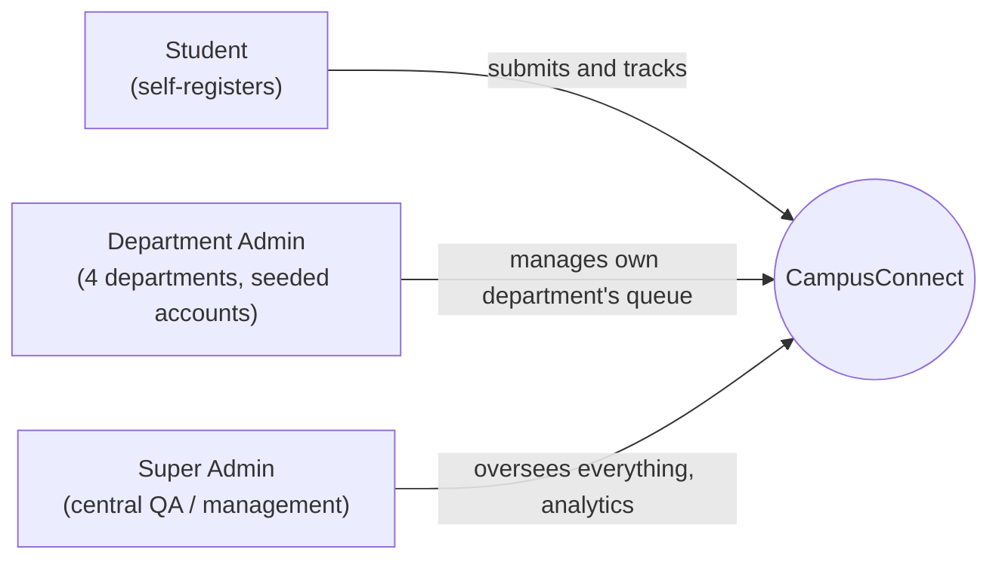

# 01 · Product & Requirements

> **Document status:** Approved for build · **Version:** 1.0 · **Owners:** Sudais Khalid, Farooq Khan
> **Source brief:** `CampusConnect_Competition_Problem_Statement.pdf` (BIIT Software Engineering Society)

## 1. Product vision

**CampusConnect** is the university's official channel for reporting campus problems and tracking them until they are resolved. Students report an issue in under a minute from their phone, the issue reaches the right department automatically, and everyone can see what happened to it. The university gets data on what keeps going wrong and where.

The brief describes a competition prototype. This design treats it as a **real product for a real university**: real students, real staff accounts, real personal data, and a system that must stay up through a full academic year without its authors watching it.

### 1.1 Problems we are solving

| Problem today | Consequence | How CampusConnect fixes it |
|---|---|---|
| Complaints are verbal, on paper, or in WhatsApp groups | They get lost, nobody owns them, and nothing is measured | One system of record, with every complaint numbered and owned by a department |
| Students don't know which office handles what | Complaints go to the wrong person or never get filed | Students pick a category and the system routes it automatically |
| No feedback loop | Students assume nothing happens and stop reporting | A status timeline, replies from staff, and push and email notifications |
| Students fear retaliation (especially about teaching) | The most important complaints never get filed | An **anonymous-to-department** option: identity is visible only to the Super Admin |
| Management can't see recurring issues | The same problems repeat every semester | Dashboards, trends, SLA tracking, and "Me too" support counts |

### 1.2 Success metrics (measured from production data)

| Metric | Target after one semester |
|---|---|
| Complaints routed without manual reassignment | ≥ 95 % |
| Median time to first response from staff | ≤ 48 hours |
| Complaints resolved within their SLA | ≥ 70 % |
| Student satisfaction rating on resolved complaints | ≥ 3.8 / 5 |
| PWA installs among active students | ≥ 30 % |
| Security incidents involving cross-department data access | 0 |

## 2. Users and roles

| Role | Who | How the account is created | What the account can see |
|---|---|---|---|
| **Student** | Enrolled students | Self-registration with university email and email verification | **Only their own** complaints |
| **Department Admin** | Staff of Cafeteria, Library, Lab/IT, Teaching/Academic | Created by the Super Admin (the four initial accounts come from seed data) | **Only their own department's** complaints |
| **Super Admin** | Quality-assurance office or management | Seeded once at deployment and protected with 2FA | All complaints, all analytics, user and department management |

## 3. Complaint categories and routing (from the brief, §3)

The student picks a **category** and, optionally, an **issue type**. The **department is derived from the category and the student never chooses it.**

| Category | Issue types (sub-categories) | Routed to |
|---|---|---|
| Cafeteria | Food quality / hygiene · High prices · Limited variety · Staff behaviour / service · Other | Cafeteria Administration |
| Library | Books / learning resources · Librarian availability / behaviour · Opening hours · Seating / study space · Other | Library Administration |
| Laboratories & IT | Non-functional computers · Internet connectivity · Projector / multimedia · Missing software · Other | Laboratory / IT Administration |
| Teaching & Academic Affairs | Teacher late to lecture · Notes / materials unavailable · Inadequate explanation · Classroom management / discipline · Other | Teaching Manager / Academic Coordination |

The mapping is stored as **data** (`Category.departmentId`), not hard-coded, so the university can add a category such as *Transport* or *Hostel* without a code change. See ADR-008.

## 4. Functional requirements

### 4.1 Traceability to the brief

Every requirement in the brief maps to a design element below. `FR-` IDs are used in tests and pull requests.

| ID | Requirement | Brief § | Designed in |
|---|---|---|---|
| FR-01 | Student registration and login | 4.1, 5.1 | [05 Security](05-security-and-access-control.md) §2 |
| FR-02 | Submit a complaint under a predefined category, with details and optional images | 4.1, 5.2 | [08 Workflows](08-core-workflows.md) §3 |
| FR-03 | Automatic routing of the complaint to its department | 4.2, 5.3 | [04 Data model](04-data-model.md) §3, ADR-008 |
| FR-04 | Students see **only** their own complaints | 4.1 | [05 Security](05-security-and-access-control.md) §4 |
| FR-05 | Track status and view responses and remarks | 4.1, 5.5 | [04 Data model](04-data-model.md) §5 |
| FR-06 | Department admins view, review and update their department's complaints | 4.1 | [06 API](06-api-design.md) |
| FR-07 | Resolve or reject **with a reason** | 4.1 | State machine, [04](04-data-model.md) §5 |
| FR-08 | Department admins see current **and previously handled** complaints | 4.1 | Admin queue filters, [06 API](06-api-design.md) |
| FR-09 | Super Admin views all complaints, with search and filter by category, department and status | 4.1 | [06 API](06-api-design.md) §4 |
| FR-10 | **Server-side** role enforcement, including denial on direct-URL access | 4.1 (highlighted) | [05 Security](05-security-and-access-control.md) §4, ADR-007 |
| FR-11 | Dashboard with total, pending, in-progress, resolved and rejected counts, scoped by role | 4.3, 5.7 | [06 API](06-api-design.md) §4.6 |
| FR-12 | Graphical reports, including a bar chart of complaints per department | 4.3, 5.8 | [02 Architecture](02-system-architecture.md) §6 |
| FR-13 | Persistent database storage | 5.6 | ADR-003, [04 Data model](04-data-model.md) |
| FR-14 | Deployed and reachable at a public URL | 6 | [09 Deployment](09-deployment-and-operations.md) |

### 4.2 Requirements beyond the brief (and why)

The brief says "innovative features … will be considered positively". Each extra below is included because it solves a real operational problem, not for show.

| ID | Feature | Why it exists |
|---|---|---|
| FX-01 | **Installable PWA** that works offline for reading complaints and queuing drafts | Students live on their phones. Campus Wi-Fi is unreliable, and a complaint written in a dead zone shouldn't be lost. |
| FX-02 | **Human reference number** (`CC-2026-000123`) | Students and staff can quote it on the phone or in person. UUIDs are unreadable. |
| FX-03 | **Status timeline** (append-only event log) | Transparency: the student sees who did what and when. It also doubles as the audit trail. |
| FX-04 | **Two-way conversation** on a complaint, plus **internal notes** that only staff can see | Staff often need more details from the student, and staff need a private place to coordinate. |
| FX-05 | **Anonymous-to-department** submission | Teaching complaints carry retaliation risk. The department sees "Anonymous student" and only the Super Admin can see the identity. |
| FX-06 | **Priority and SLA due date**, with an overdue flag and escalation to the Super Admin | Without deadlines, queues rot. Escalation gives management a lever. |
| FX-07 | **"Me too" support** on existing complaints, plus a **similar-complaint suggestion** shown while typing | Cuts duplicates and turns "monitor recurring issues" (brief §1) into a number. |
| FX-08 | **Reopen** within 7 days of resolution, and a **satisfaction rating** | Stops "resolved" being used to close tickets that weren't fixed, and measures quality. |
| FX-09 | **Notifications**: in-app, Web Push and email | Students shouldn't have to keep checking the app. Push works on Android, desktop and installed iOS apps. |
| FX-10 | **Reassignment** by the Super Admin when a complaint lands in the wrong department | Students sometimes choose the wrong category. The fix is recorded in the timeline. |
| FX-11 | **CSV export** of filtered complaints | Management reports go to committees that use spreadsheets. |
| FX-12 | **Security audit log**, including denied access attempts | Accountability in a system that handles complaints about staff. |
| FX-13 | **Admin 2FA (TOTP)** | Admin accounts can read sensitive student complaints, so a password alone isn't enough. |
| FX-14 | **Withdraw** a pending complaint | Students fix mistakes themselves instead of emailing an admin. |

## 5. Non-functional requirements

| Quality | Requirement | How it is met |
|---|---|---|
| **Security** | OWASP Top 10 addressed. Server-side authorization on every read and write. Admin 2FA. | [05 Security](05-security-and-access-control.md) |
| **Privacy** | Data minimization. Image EXIF (GPS) stripped. Anonymous mode. Caches purged on logout on shared devices. | ADR-011, ADR-020, [07 PWA](07-pwa-and-mobile.md) |
| **Availability** | 99.5 % monthly during semesters, excluding provider-wide outages | Managed multi-AZ services, health checks, instant rollback |
| **Performance** | p95 server response ≤ 300 ms for API calls and ≤ 500 ms TTFB for pages, measured from Pakistan | App and database co-located in Singapore, indexed queries, CDN for static assets |
| **Mobile UX** | Usable on a 360 px wide Android phone over 3G. LCP ≤ 2.5 s on mid-range devices. | Mobile-first UI, Server Components (less JS), image compression |
| **Accessibility** | WCAG 2.2 AA | Radix primitives, axe checks in E2E tests, colour-contrast tokens |
| **Recoverability** | RPO ≤ 15 min, RTO ≤ 1 h | Neon point-in-time restore plus a nightly logical backup to object storage |
| **Maintainability** | Typed end to end, layered modules, ≥ 80 % unit coverage on domain and policy code | [10 Standards](10-engineering-standards-and-testing.md) |
| **Portability** | Can move to university-owned servers without a rewrite | Standard protocols only (Postgres, S3, SMTP/HTTP, Redis) and a Docker image. ADR-022. |
| **Compatibility** | Last two versions of Chrome, Edge, Firefox and Safari. Android 9+. iOS 16.4+ (needed for push). | Progressive enhancement: core flows work without JS-only APIs |

## 6. Capacity estimate

The design targets the numbers below **with 10× headroom**.

| Input | Assumption |
|---|---|
| Students | 8,000 enrolled, 2,000 daily active at peak (exam weeks, semester start) |
| Staff accounts | ~40 (4 departments × up to 8 staff, plus super admins) |
| Complaints | 20 % of students file 2 per semester → **~3,200 per semester** (~25/day average, ~250/day peak) |
| Attachments | ≤ 3 images per complaint, ~250 KB each after compression → **< 2.5 GB per semester** worst case |
| Requests | ~40k requests per day at peak → well under 5 rps on average and ~20-30 rps at the peak minute |
| Database size | < 1 GB after 5 years (text rows are tiny) |

**Conclusion:** throughput is not the hard problem. The architecture puts **correctness of authorization, data integrity, reliability, low operating cost and easy operation** first, because those are the things a university IT team actually suffers from.

## 7. Assumptions and constraints

1. Students have a university email address (configurable domain allow-list, e.g. `@biit.edu.pk`). If the university can't guarantee this, the allow-list can be turned off and students verify with registration number plus email instead.
2. The departments in the brief are the departments at launch. More can be added through the admin UI.
3. Staff use the system in English. The UI is built i18n-ready so Urdu can be added later (Phase 3).
4. All timestamps are stored in UTC and displayed in **Asia/Karachi**.
5. The initial deployment is cloud-hosted (Vercel, Neon, Cloudflare R2). University IT can later move it on-premises (ADR-022).

## 8. Out of scope (v1)

- Native app-store apps. The PWA covers this, and Capacitor wrapping is possible later.
- University SSO (Microsoft 365 / Google Workspace OIDC). Planned for Phase 3, and Better Auth supports it.
- Integrations with timetable or LMS systems.
- AI auto-categorization. Possible later as a *suggestion*, never as an automatic route.

## 9. Glossary

| Term | Meaning |
|---|---|
| **Complaint** | A report from a student about a campus problem. The core entity. |
| **Category** | The student-facing grouping (Cafeteria, Library…). Determines the department. |
| **Issue type** | A finer sub-category within a category, used for analytics. |
| **Department** | The organizational unit that owns and resolves a complaint. |
| **Routing** | Automatically assigning a department based on category. |
| **SLA** | The target time to resolve, derived from priority. |
| **Event** | An immutable timeline entry (created, status changed, commented…). |
| **Scope** | The set of complaints an actor may access: own, own department, or all. |
| **DAL** | Data Access Layer: the only code allowed to query complaints, and where scope is enforced. |
