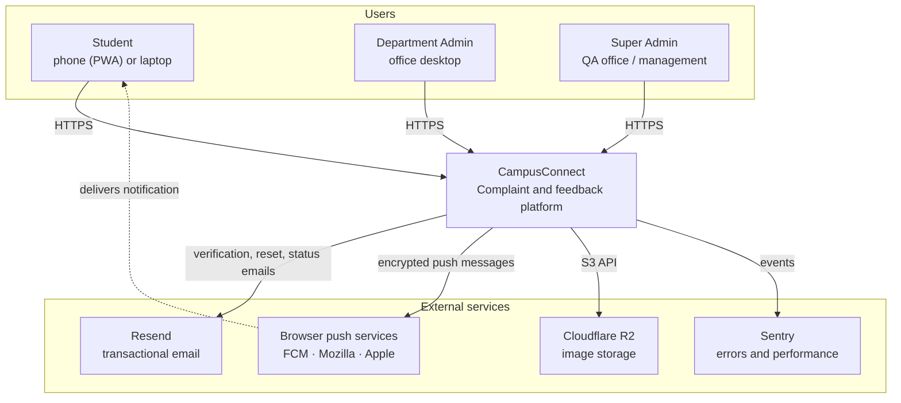
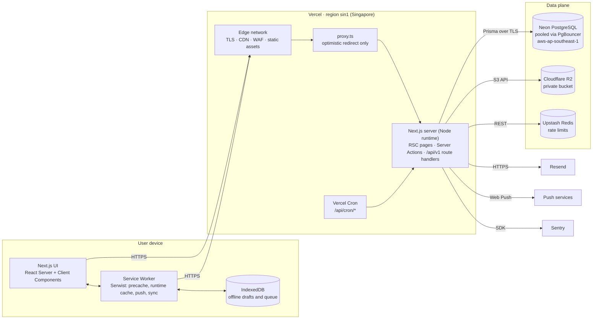
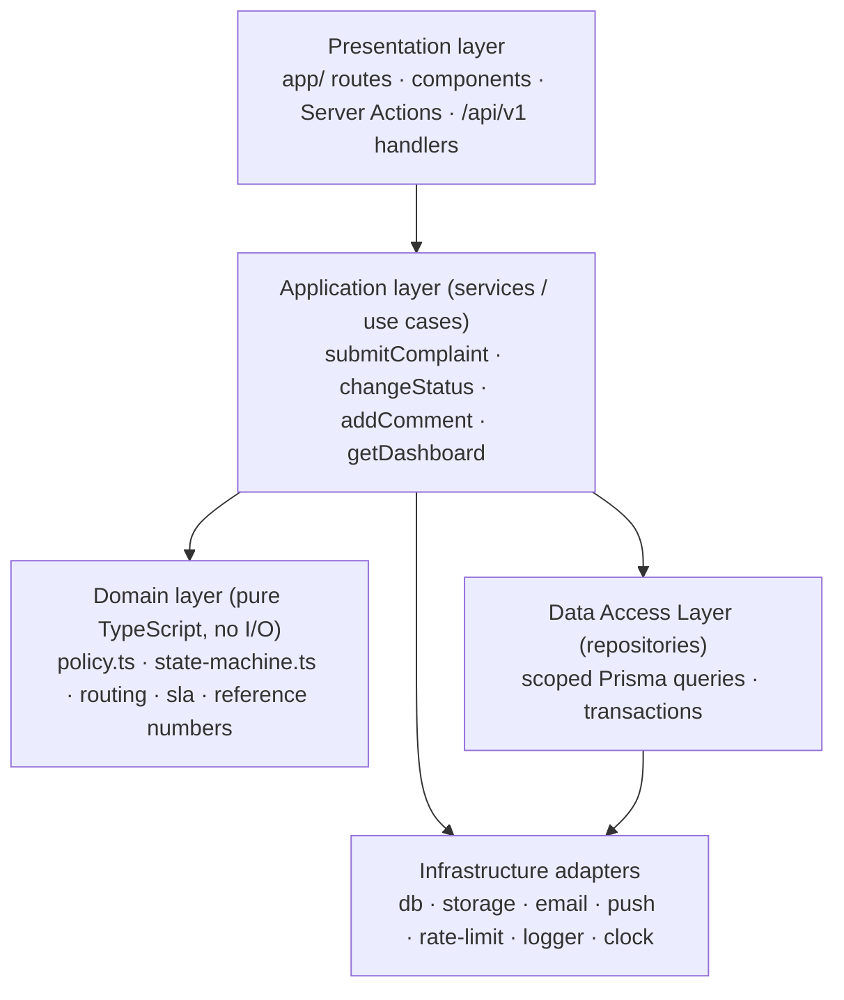
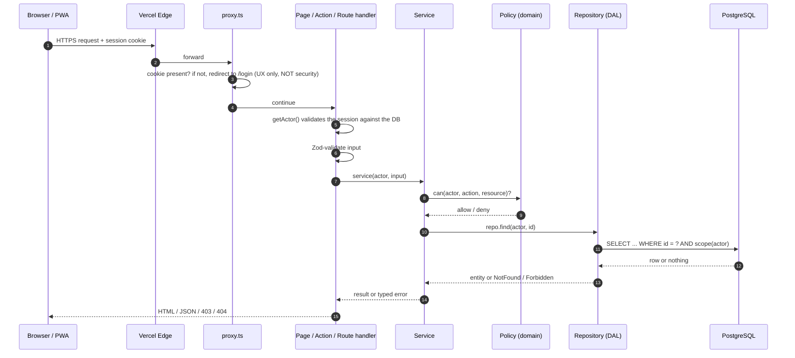

# 02 · System Architecture

> **Style:** a modular monolith built with Next.js (App Router), deployed serverless on Vercel, backed by PostgreSQL (Neon), S3-compatible object storage (Cloudflare R2) and Redis (Upstash).
> Every choice on this page is justified in [03 · Architecture Decisions](03-architecture-decisions.md).

## 1. Architecture at a glance

| Concern | Choice | One-line reason | ADR |
|---|---|---|---|
| Architecture style | Modular monolith | One team, one domain, low throughput. Microservices would add operations cost and give nothing back. | 001 |
| Application framework | Next.js (App Router) + React 19 + TypeScript (strict) | One deployable for UI and API, server-rendered pages, server-side auth next to the data | 002 |
| Database | PostgreSQL (Neon, serverless, pooled) | The data is relational: joins, foreign keys, transactions and SQL analytics | 003, 005 |
| ORM and migrations | Prisma | Type-safe queries, a readable schema and versioned migrations | 004 |
| Authentication | Better Auth (email and password, email verification, TOTP 2FA, database sessions) | Sessions can be revoked, and none of the security-critical auth code is our own | 006 |
| Authorization | Policy module plus a scoped Data Access Layer | Enforced on the server, on every query, and testable | 007 |
| File storage | Cloudflare R2 (private bucket), images re-encoded with `sharp` | No egress fees. Removes EXIF and malicious payloads. | 011 |
| PWA | Serwist (Workbox-based service worker) + Web App Manifest | Installable, offline reads, offline draft queue, push | 012 |
| Notifications | In-app table + Web Push (VAPID) + email (Resend) | Reaches students without them polling the app | 013 |
| Rate limiting | Upstash Redis (`@upstash/ratelimit`) | Works across serverless instances, where in-memory counters don't | 014 |
| Search | PostgreSQL full-text search + `pg_trgm` | Good enough at this scale, with nothing extra to run | 015 |
| UI kit and charts | Tailwind CSS v4 + shadcn/ui (Radix) + Recharts | Accessible primitives, our own design tokens, SVG charts | 018 |
| Validation | Zod (inputs, env, API contracts) | One schema serves as type, validator and OpenAPI source | 019 |
| Hosting | Vercel (region `sin1`) + Neon (`aws-ap-southeast-1`) | Co-located in Singapore, the lowest-latency region for Pakistan | 005 |
| Observability | Sentry + structured JSON logs (pino) + `/api/health` + uptime monitor | You can't operate what you can't see | 023 |
| CI/CD | GitHub Actions + Vercel preview deploys + a Neon branch per PR | Every PR is tested against a real database copy | 024 |

## 2. System context (C4 level 1)

Who uses the system and what it depends on.



## 3. Containers (C4 level 2)

The deployable and runtime pieces, and how they talk to each other.



**Key point:** there is **one application container**. Pages, Server Actions, REST endpoints and cron jobs all run the same code and call the same service layer, so a business rule exists in exactly one place.

## 4. Layered architecture inside the monolith



### 4.1 Dependency rules (checked by ESLint `import/no-restricted-paths`)

1. **Presentation never touches Prisma.** Pages and route handlers call services only.
2. **The domain layer is pure.** No imports of `next`, `prisma` or `fetch`. That keeps the policy and the state machine unit-testable in milliseconds.
3. **Only repositories query complaint data**, and every repository function takes the `actor` as its **first argument**. A query without an actor won't compile.
4. **Infrastructure sits behind interfaces** (`StorageService`, `Mailer`, `PushSender`, `RateLimiter`). Production uses R2, Resend and Upstash. Tests use in-memory fakes. A self-hosted deployment uses MinIO, SMTP and Redis (ADR-022).
5. **Server-only code** imports `server-only`, so it can never be bundled into the browser by accident.

### 4.2 Why layered (and not "everything in the route handler")

The brief's critical requirement is **authorization that can't be bypassed**. If authorization lived in each page or handler, one forgotten check would be a data leak. Putting it in the **Data Access Layer**, where it cannot be skipped, makes the safe path the only path. See [05 · Security](05-security-and-access-control.md).

## 5. Modules (bounded contexts)

| Module | Responsibility | Owns tables |
|---|---|---|
| `auth` | Registration, login, sessions, email verification, password reset, 2FA | `User`, `Session`, `Account`, `Verification`, `TwoFactor` |
| `org` | Departments, categories, issue types, the routing table, admin account management | `Department`, `Category`, `IssueType` |
| `complaints` | Complaint lifecycle, state machine, comments, support ("me too"), ratings, search | `Complaint`, `ComplaintEvent`, `ComplaintComment`, `ComplaintSupport` |
| `attachments` | Image validation, re-encoding, storage and signed URL access | `Attachment` |
| `notifications` | In-app notifications, push subscriptions, email and push delivery with retries | `Notification`, `PushSubscription`, `NotificationDelivery` |
| `analytics` | Dashboard counts, charts, SLA metrics, CSV export (read-only) | none (reads `Complaint` through the DAL) |
| `audit` | Security and admin action log | `AuditLog` |

Modules talk to each other through exported service functions, never by reaching into another module's tables. For example, `complaints` calls `notifications.notify(...)` after a status change.

## 6. Analytics and charts design

| Widget | Super Admin | Department Admin | Chart type | Why that chart |
|---|---|---|---|---|
| KPI cards: Total · Pending · In progress · Resolved · Rejected · Overdue | all departments | own department | Stat tiles | The brief's §4.3 list, plus Overdue as the actionable one |
| Complaints by department | Yes | No | **Bar chart** (required by the brief) | Comparing magnitudes across categories |
| Status breakdown | Yes | Yes | Stacked bar or donut | Part-to-whole across 4-5 states |
| Complaints over time (weekly) | Yes | Yes | Line or area chart | Trends, e.g. semester start or exam weeks |
| Top issue types | Yes | Yes | Horizontal bar | Long labels read better horizontally. Shows recurring problems. |
| Average resolution time per department | Yes | own only | Bar (hours) | Measures department responsiveness |
| SLA compliance % | Yes | Yes | Stat + bar | Makes deadlines visible |
| Satisfaction (average rating) | Yes | Yes | Stat | Quality, not just speed |

All analytics come from **SQL aggregate queries** (`GROUP BY`, `date_trunc`, `percentile_cont`) through the same scoped DAL. A department admin's dashboard therefore **can't** include other departments' numbers, even through the API. Results are cached for 60 seconds per scope (ADR-016).

## 7. Request lifecycle (where each check happens)



**Three independent layers of protection:** (1) the session is validated against the database on every request, (2) the policy checks the action, and (3) the **SQL itself is scoped**, so even a buggy policy can't return rows outside the actor's scope.

## 8. Source code layout

```text
campusconnect/
├─ src/
│  ├─ app/                         # Next.js App Router (presentation only)
│  │  ├─ (public)/                 # login, register, verify-email, reset-password
│  │  ├─ (student)/student/        # dashboard, complaints, complaints/new, complaints/[id]
│  │  ├─ (admin)/admin/            # dashboard, complaints, complaints/[id], analytics, users, settings
│  │  ├─ api/v1/                   # versioned REST route handlers
│  │  ├─ api/auth/[...all]/        # Better Auth handler
│  │  ├─ api/cron/                 # SLA escalation, delivery retries, cleanup
│  │  ├─ api/health/               # liveness + DB readiness
│  │  ├─ ~offline/                 # offline fallback page
│  │  ├─ manifest.ts               # Web App Manifest
│  │  └─ sw.ts                     # service worker source (Serwist)
│  ├─ modules/
│  │  ├─ complaints/   {service, repository, schemas, actions, events}.ts
│  │  ├─ org/          {service, repository, schemas}.ts
│  │  ├─ attachments/  {service, image-pipeline}.ts
│  │  ├─ notifications/{service, push, email, templates/}.ts
│  │  ├─ analytics/    {service, queries}.ts
│  │  └─ audit/        {service}.ts
│  ├─ domain/                      # pure logic: policy, state machine, SLA, reference numbers
│  ├─ lib/                         # db, auth, env, logger, errors, rate-limit, storage, crypto
│  ├─ components/                  # ui/ (shadcn), charts/, complaints/, layout/
│  └─ proxy.ts                     # optimistic auth redirect (Next.js 16 name for middleware)
├─ prisma/  schema.prisma · migrations/ · seed.ts
├─ tests/   unit/ · integration/ · e2e/
├─ public/  icons/ · screenshots/
├─ docs/    (this documentation)
└─ .github/workflows/ ci.yml · deploy.yml · backup.yml
```

## 9. Cross-cutting concerns

| Concern | Approach |
|---|---|
| **Configuration** | `src/lib/env.ts` parses `process.env` with Zod at boot. A missing or invalid variable stops the deploy instead of failing at 2 a.m. |
| **Errors** | Typed domain errors (`NotFoundError`, `ForbiddenError`, `ConflictError`, `ValidationError`, `RateLimitedError`) map to HTTP codes in one place. The API returns RFC 9457 `application/problem+json`. Users never see stack traces. |
| **Logging** | pino JSON logs carrying `requestId`, `actorId`, `role` and `route`, with **no** passwords, tokens or complaint text. Logs are shipped through a Vercel log drain. |
| **Time** | Stored as `timestamptz` in UTC and rendered in `Asia/Karachi`. A `Clock` adapter lets SLA logic be tested deterministically. |
| **Caching** | Static assets: immutable CDN cache. Pages that depend on the user: `no-store` at the CDN. Analytics: 60-second server cache per scope. PWA: see [07](07-pwa-and-mobile.md). |
| **Transactions** | Any write that touches more than one table (complaint + event + notification) runs in a single `prisma.$transaction`. |
| **Idempotency** | Complaint creation accepts a client-generated `Idempotency-Key`, so an offline draft replayed twice creates **one** complaint. |
| **i18n** | All UI strings go through a message catalogue (`next-intl`), so Urdu with right-to-left layout can be added in Phase 3 without hunting for hard-coded strings. |
| **Accessibility** | Radix primitives (focus traps, ARIA), visible focus rings, `prefers-reduced-motion`, colour-contrast-checked tokens, axe checks in CI. |
