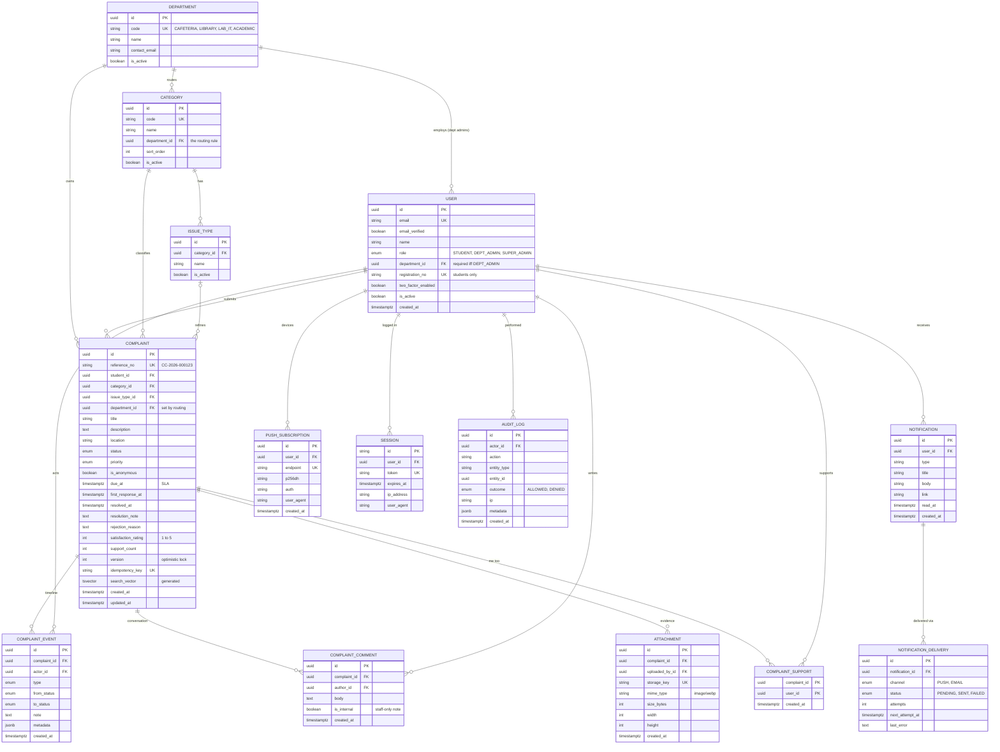
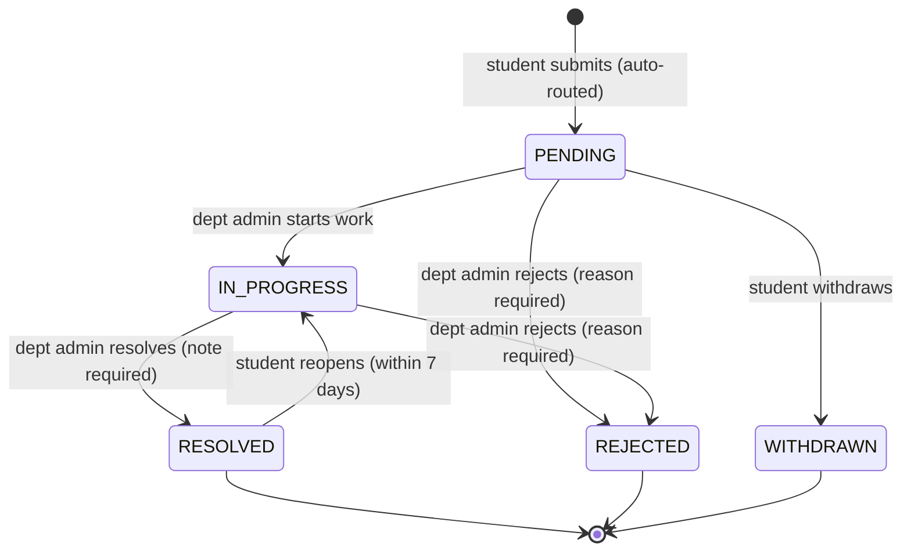

# 04 · Data Model & Database Design

> **Engine:** PostgreSQL 16+ (Neon) · **Access:** Prisma ORM · **Conventions:** `snake_case` tables and columns in SQL, `camelCase` in TypeScript (Prisma `@map`), `timestamptz` everywhere, UUIDv7 keys.
> Decisions: ADR-003 (PostgreSQL), ADR-004 (Prisma), ADR-008 (routing as data), ADR-009 (state machine), ADR-021 (keys).

## 1. Entity relationship diagram



Better Auth also owns `account` (password hash and future SSO links), `verification` (email and reset tokens) and `two_factor` (TOTP secret, backup codes). They are left out of the diagram for clarity.

## 2. Enumerations

| Enum | Values | Notes |
|---|---|---|
| `Role` | `STUDENT`, `DEPT_ADMIN`, `SUPER_ADMIN` | A user has exactly one role. |
| `ComplaintStatus` | `PENDING`, `IN_PROGRESS`, `RESOLVED`, `REJECTED`, `WITHDRAWN` | The first four come from the brief. `WITHDRAWN` (FX-14) is excluded from department performance metrics. |
| `Priority` | `LOW`, `MEDIUM`, `HIGH`, `URGENT` | Defaults to `MEDIUM`. Set by staff. Drives the SLA. |
| `EventType` | `CREATED`, `STATUS_CHANGED`, `PRIORITY_CHANGED`, `REASSIGNED`, `COMMENTED`, `REOPENED`, `RATED`, `ATTACHMENT_ADDED`, `IDENTITY_REVEALED` | Drives the timeline and analytics. |
| `DeliveryChannel` | `PUSH`, `EMAIL` | In-app notifications are the `Notification` row itself. |
| `DeliveryStatus` | `PENDING`, `SENT`, `FAILED` | `FAILED` means every retry was used up. |
| `AuditOutcome` | `ALLOWED`, `DENIED` | Denied access attempts are logged deliberately. |

## 3. Routing (FR-03)

Routing is a **join**, not code:

```sql
-- Seed data (the brief's section 3)
INSERT INTO department (code, name) VALUES
  ('CAFETERIA', 'Cafeteria Administration'),
  ('LIBRARY',   'Library Administration'),
  ('LAB_IT',    'Laboratory / IT Administration'),
  ('ACADEMIC',  'Teaching Manager / Academic Coordination');

-- Each category points at exactly one department
INSERT INTO category (code, name, department_id) VALUES
  ('CAFETERIA', 'Cafeteria',                    (SELECT id FROM department WHERE code = 'CAFETERIA')),
  ('LIBRARY',   'Library',                      (SELECT id FROM department WHERE code = 'LIBRARY')),
  ('LAB_IT',    'Laboratories & IT Facilities', (SELECT id FROM department WHERE code = 'LAB_IT')),
  ('ACADEMIC',  'Teaching & Academic Affairs',  (SELECT id FROM department WHERE code = 'ACADEMIC'));
```

On submission the service runs `SELECT department_id FROM category WHERE id = $1 AND is_active` and copies the result into `complaint.department_id` inside the creation transaction. The request body has **no** department field.

## 4. Integrity constraints (enforced by the database, not just by code)

| Constraint | SQL | Protects against |
|---|---|---|
| Dept admin must have a department | `CHECK (role <> 'DEPT_ADMIN' OR department_id IS NOT NULL)` | An admin who can see nothing, or everything, by accident |
| Students and super admins have no department | `CHECK (role = 'DEPT_ADMIN' OR department_id IS NULL)` | Scope confusion |
| Rejected needs a reason | `CHECK (status <> 'REJECTED' OR length(trim(rejection_reason)) >= 10)` | Silent rejections (brief §4.1) |
| Resolved needs a note | `CHECK (status <> 'RESOLVED' OR length(trim(resolution_note)) >= 10)` | "Resolved" with no explanation |
| Rating range | `CHECK (satisfaction_rating BETWEEN 1 AND 5)` | Bad analytics |
| Rating only when resolved | `CHECK (satisfaction_rating IS NULL OR status = 'RESOLVED')` | Rating unfinished work |
| Text sizes | `CHECK (length(title) BETWEEN 5 AND 120)`, `CHECK (length(description) BETWEEN 20 AND 5000)` | Abuse and storage bloat |
| Unique reference | `UNIQUE (reference_no)` | Duplicate ticket numbers |
| Idempotent create | `UNIQUE (student_id, idempotency_key)` | Duplicate complaints from offline replay |
| One "me too" per person | `PRIMARY KEY (complaint_id, user_id)` | Vote stuffing |
| Foreign keys | `ON DELETE RESTRICT` on complaint parents | Deleting a department or user that still has complaints |

**Why constraints in the DB as well as in Zod?** Zod protects the API. Constraints protect the **data**, including against future code paths, scripts, admin consoles and bugs. They are the last line of defense and cost nothing at runtime.

## 5. Complaint lifecycle (state machine)



| From | To | Who may do it | Required data | Side effects |
|---|---|---|---|---|
| (new) | `PENDING` | Student (owner) | category, title, description | routing, SLA `due_at`, reference no, `CREATED` event, notify dept admins |
| `PENDING` | `IN_PROGRESS` | Dept admin (same dept), Super Admin | optional note | sets `first_response_at` if null, notify student |
| `PENDING` / `IN_PROGRESS` | `REJECTED` | Dept admin (same dept), Super Admin | `rejection_reason` ≥ 10 chars | notify student |
| `IN_PROGRESS` | `RESOLVED` | Dept admin (same dept), Super Admin | `resolution_note` ≥ 10 chars | `resolved_at`, notify student, invite rating |
| `PENDING` | `WITHDRAWN` | Student (owner) | optional reason | notify dept admins |
| `RESOLVED` | `IN_PROGRESS` | Student (owner) within 7 days of `resolved_at`, once | reason ≥ 10 chars | `REOPENED` event, clear `resolved_at`, notify dept admins |

The table is encoded once in `domain/state-machine.ts`:

```ts
// domain/state-machine.ts  (pure, no I/O)
export const TRANSITIONS = {
  PENDING:     { IN_PROGRESS: ["DEPT_ADMIN", "SUPER_ADMIN"], REJECTED: ["DEPT_ADMIN", "SUPER_ADMIN"], WITHDRAWN: ["OWNER"] },
  IN_PROGRESS: { RESOLVED:    ["DEPT_ADMIN", "SUPER_ADMIN"], REJECTED: ["DEPT_ADMIN", "SUPER_ADMIN"] },
  RESOLVED:    { IN_PROGRESS: ["OWNER"] },        // reopen; time window checked by a guard
  REJECTED:    {},
  WITHDRAWN:   {},
} as const satisfies Record<ComplaintStatus, Partial<Record<ComplaintStatus, readonly Actor[]>>>;
```

## 6. SLA rules

| Priority | Target resolution time | Typical example |
|---|---|---|
| `URGENT` | 24 hours | Lab-wide internet outage during exams, hygiene hazard |
| `HIGH` | 72 hours | Projector broken in a lecture hall |
| `MEDIUM` (default) | 7 days | Limited food variety, outdated books |
| `LOW` | 14 days | Suggestion-type issues |

`due_at = created_at + sla(priority)` is recalculated when priority changes. A complaint is **overdue** when `due_at < now()` and `status IN ('PENDING','IN_PROGRESS')`. The hourly cron `/api/cron/sla` notifies the department and, after 24 hours overdue, **escalates to the Super Admin**. SLA hours are configurable per department in Phase 2.

## 7. Indexes (designed from the actual queries)

| Query | Index | Why |
|---|---|---|
| Dept admin queue: `WHERE department_id = ? AND status = ? ORDER BY created_at DESC` | `(department_id, status, created_at DESC)` | The busiest admin query. Covers filter and sort. |
| Student "my complaints": `WHERE student_id = ? ORDER BY created_at DESC` | `(student_id, created_at DESC)` | Student home screen |
| Super admin filters by category or status | `(category_id, status)`, `(status, created_at DESC)` | Global filtering |
| Overdue scan | `(status, due_at)` | Fast hourly SLA cron |
| Full-text search | `GIN (search_vector)` | ADR-015 |
| Similar-complaint suggestion | `GIN (title gin_trgm_ops)` | Fuzzy title match in the same category |
| Timeline | `complaint_event (complaint_id, created_at)` | Complaint detail page |
| Unread notifications | `notification (user_id, read_at)` | Badge count |
| Delivery retries | `notification_delivery (status, next_attempt_at)` | Retry cron |
| Audit lookup | `audit_log (entity_type, entity_id, created_at)`, `audit_log (actor_id, created_at)` | Investigations |

Foreign-key columns are indexed so joins and `ON DELETE RESTRICT` checks don't scan tables.

## 8. Reference number generation

```sql
CREATE SEQUENCE complaint_ref_seq;
-- In the creation transaction:
--   'CC-' || to_char(now() AT TIME ZONE 'Asia/Karachi', 'YYYY') || '-' || lpad(nextval('complaint_ref_seq')::text, 6, '0')
```

The sequence is global (it doesn't reset each year). That avoids a race at year boundaries and keeps numbers unique without coordination. The year prefix is for readability only.

## 9. Search vector (generated column)

```sql
ALTER TABLE complaint ADD COLUMN search_vector tsvector
  GENERATED ALWAYS AS (
    setweight(to_tsvector('simple', coalesce(reference_no, '')), 'A') ||
    setweight(to_tsvector('english', coalesce(title, '')), 'A') ||
    setweight(to_tsvector('english', coalesce(description, '')), 'B')
  ) STORED;
CREATE INDEX complaint_search_idx ON complaint USING GIN (search_vector);
CREATE EXTENSION IF NOT EXISTS pg_trgm;
CREATE INDEX complaint_title_trgm_idx ON complaint USING GIN (title gin_trgm_ops);
```

## 10. Prisma schema (core excerpt, draft v1)

```prisma
// Preview flags differ between Prisma majors; confirm against the pinned version at scaffold time.
generator client {
  provider        = "prisma-client-js"
  previewFeatures = ["driverAdapters", "postgresqlExtensions"]
}

datasource db {
  provider  = "postgresql"
  url       = env("DATABASE_URL")          // pooled (PgBouncer) for runtime
  directUrl = env("DATABASE_URL_UNPOOLED") // direct, for migrations
  extensions = [pgTrgm(map: "pg_trgm")]
}

enum Role            { STUDENT DEPT_ADMIN SUPER_ADMIN }
enum ComplaintStatus { PENDING IN_PROGRESS RESOLVED REJECTED WITHDRAWN }
enum Priority        { LOW MEDIUM HIGH URGENT }

model Department {
  id           String      @id @default(uuid(7)) @db.Uuid
  code         String      @unique
  name         String
  contactEmail String?     @map("contact_email")
  isActive     Boolean     @default(true) @map("is_active")
  categories   Category[]
  admins       User[]
  complaints   Complaint[]
  @@map("department")
}

model Category {
  id           String      @id @default(uuid(7)) @db.Uuid
  code         String      @unique
  name         String
  departmentId String      @map("department_id") @db.Uuid
  department   Department  @relation(fields: [departmentId], references: [id], onDelete: Restrict)
  sortOrder    Int         @default(0) @map("sort_order")
  isActive     Boolean     @default(true) @map("is_active")
  issueTypes   IssueType[]
  complaints   Complaint[]
  @@index([departmentId])
  @@map("category")
}

model Complaint {
  id                 String          @id @default(uuid(7)) @db.Uuid
  referenceNo        String          @unique @map("reference_no")
  studentId          String          @map("student_id") @db.Uuid
  categoryId         String          @map("category_id") @db.Uuid
  issueTypeId        String?         @map("issue_type_id") @db.Uuid
  departmentId       String          @map("department_id") @db.Uuid
  title              String          @db.VarChar(120)
  description        String
  location           String?         @db.VarChar(120)
  status             ComplaintStatus @default(PENDING)
  priority           Priority        @default(MEDIUM)
  isAnonymous        Boolean         @default(false) @map("is_anonymous")
  dueAt              DateTime        @map("due_at") @db.Timestamptz
  firstResponseAt    DateTime?       @map("first_response_at") @db.Timestamptz
  resolvedAt         DateTime?       @map("resolved_at") @db.Timestamptz
  resolutionNote     String?         @map("resolution_note")
  rejectionReason    String?         @map("rejection_reason")
  satisfactionRating Int?            @map("satisfaction_rating") @db.SmallInt
  supportCount       Int             @default(0) @map("support_count")
  reopenCount        Int             @default(0) @map("reopen_count")
  version            Int             @default(1)
  idempotencyKey     String?         @map("idempotency_key") @db.VarChar(64)
  createdAt          DateTime        @default(now()) @map("created_at") @db.Timestamptz
  updatedAt          DateTime        @updatedAt @map("updated_at") @db.Timestamptz

  student     User               @relation("StudentComplaints", fields: [studentId], references: [id], onDelete: Restrict)
  category    Category           @relation(fields: [categoryId], references: [id], onDelete: Restrict)
  issueType   IssueType?         @relation(fields: [issueTypeId], references: [id], onDelete: SetNull)
  department  Department         @relation(fields: [departmentId], references: [id], onDelete: Restrict)
  events      ComplaintEvent[]
  comments    ComplaintComment[]
  attachments Attachment[]
  supporters  ComplaintSupport[]

  @@unique([studentId, idempotencyKey])
  @@index([departmentId, status, createdAt(sort: Desc)])
  @@index([studentId, createdAt(sort: Desc)])
  @@index([categoryId, status])
  @@index([status, createdAt(sort: Desc)])
  @@map("complaint")
}
// User, IssueType, ComplaintEvent, ComplaintComment, Attachment, ComplaintSupport,
// Notification, NotificationDelivery, PushSubscription, AuditLog follow the ERD above.
// CHECK constraints, the generated search_vector and the partial/trigram indexes are
// added in hand-edited SQL inside the migration (Prisma does not model them).
```

## 11. Data retention and privacy

| Data | Retention | Reason |
|---|---|---|
| Complaints, events, comments | 5 academic years, then anonymized (student link removed, text kept for trend analysis) | Institutional record vs. data minimization |
| Attachments | Deleted 2 years after the complaint closes | Images are the most identifying data |
| Sessions | Deleted on expiry (daily cron) | Hygiene |
| Audit log | 3 years, append-only | Accountability investigations |
| Notifications | 180 days | Only useful while recent |
| Deactivated student accounts | Personal fields anonymized on request after graduation | Right to erasure, balanced against record keeping |

All retention periods are **configuration**, to be confirmed with university administration before launch.

## 12. Seed data (demo and initial production)

| Account | Role | Department | Notes |
|---|---|---|---|
| `superadmin@<domain>` | SUPER_ADMIN | none | Production: random password printed once, forced reset and 2FA on first login |
| `cafeteria.admin@<domain>` | DEPT_ADMIN | Cafeteria | |
| `library.admin@<domain>` | DEPT_ADMIN | Library | |
| `labit.admin@<domain>` | DEPT_ADMIN | Lab / IT | |
| `academic.admin@<domain>` | DEPT_ADMIN | Teaching / Academic | |

The **demo seed** (preview environments only, guarded by `APP_ENV !== "production"`) also creates sample students and around 60 complaints spread over 8 weeks, so charts look realistic in demonstrations. The production seed creates **only** departments, categories, issue types and the admin accounts above.
