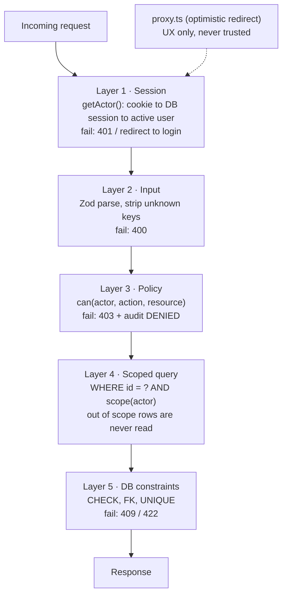
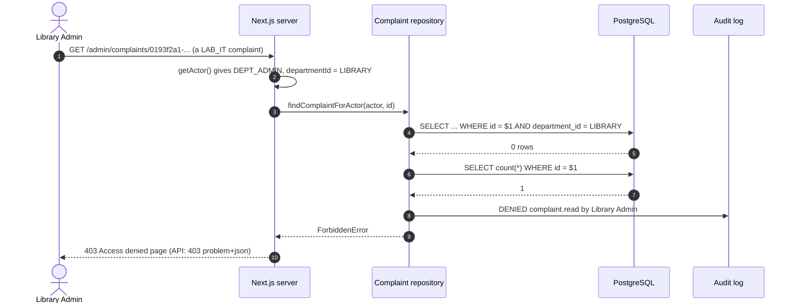

# 05 · Security & Access Control

> The brief's highlighted requirement is **server-side authorization**. This document shows exactly how it is enforced and how the rest of the system is hardened to production standards (OWASP Top 10, privacy, secrets, supply chain).
> Decisions: ADR-006 (auth), ADR-007 (authorization), ADR-011 (uploads), ADR-014 (rate limits), ADR-020 (anonymity).

## 1. Security principles

1. **Deny by default.** No route, action or query is public unless explicitly marked public.
2. **Authorize at the data.** Permission is checked where the data is read or written (the DAL), not where the button is drawn.
3. **Never trust the client.** Department, status, owner, priority and role are **derived or checked on the server**, never accepted from input.
4. **Least privilege.** Each role sees the minimum data needed. Department admins get anonymized projections where required.
5. **Defense in depth.** Session validation, then the policy check, then the scoped SQL, then database constraints, then the audit log.
6. **Secure by construction.** Make the unsafe thing hard to write: repository functions **require** an `actor` argument.

## 2. Authentication

| Aspect | Design | Why |
|---|---|---|
| Student registration | Name, university email (domain allow-list), registration number (format regex), password | Only real students can register |
| Email verification | Required before the first complaint. Link token valid for 24 h, single use. | Stops fake accounts and confirms the inbox |
| Password policy | Min 10 chars, checked against breached-password lists (HIBP k-anonymity), no composition rules | NIST SP 800-63B guidance: length and breach checks beat complexity rules |
| Hashing | scrypt (Better Auth default) | Memory-hard, so offline cracking is expensive |
| Sessions | Random token in an httpOnly, `Secure`, `SameSite=Lax` cookie with the `__Secure-` prefix, stored in the DB | No JS access (XSS can't steal it), revocable server-side |
| Session lifetime | Students: 7 days sliding. Admins: 12 h idle, 7 days absolute. | Admins hold more sensitive access |
| Admin 2FA | TOTP (authenticator app) **mandatory** for `DEPT_ADMIN` and `SUPER_ADMIN`, with one-time backup codes | A stolen password alone can't open admin data |
| Brute force | 5 attempts / 15 min per IP+email (ADR-014), constant-time responses, generic error ("Invalid email or password") | Prevents credential stuffing and account enumeration |
| Password reset | Single-use token, 30 min expiry, all sessions revoked after reset | Standard secure reset |
| Admin provisioning | Super Admin creates dept admins. A temporary password is emailed and must be changed, and 2FA set up, on first login. | No self-registration for admins (brief §4.1) |
| Deactivation | `is_active = false` plus all of the user's sessions deleted immediately | Staff turnover |

## 3. Permission matrix (RBAC + ownership)

`Own` = the student who submitted it. `Dept` = complaints whose `department_id` equals the admin's department.

| Action | Student | Dept Admin | Super Admin |
|---|---|---|---|
| Register / log in | Yes | Log in only | Log in only |
| Create complaint | Yes | No | No |
| List complaints | Own | Dept | All |
| View complaint detail | Own | Dept | All |
| View student identity on anonymous complaint | Own (self) | **No** (masked) | Yes (audited) |
| Upload attachment | Own, while `PENDING` or `IN_PROGRESS` | Dept | All |
| View attachment | Own | Dept | All |
| Comment (public) | Own | Dept | All |
| Internal note (staff only) | **No** (and can't read them) | Dept | All |
| Change status: start, resolve, reject | No | Dept | All |
| Withdraw (`PENDING` to `WITHDRAWN`) | Own | No | No |
| Reopen (`RESOLVED` to `IN_PROGRESS`, 7 days) | Own | No | No |
| Rate resolution | Own, when `RESOLVED` | No | No |
| "Me too" support | Any complaint visible to them in the public similar-issue list | No | No |
| Change priority | No | Dept | All |
| Reassign to another department | No | No | Yes |
| Dashboard and analytics | Own summary | Dept | All departments |
| Export CSV | No | Dept | All |
| Manage departments, categories, admins | No | No | Yes |
| View audit log | No | No | Yes |

**About "Me too":** the similar-issue suggestion shows only **title, category, status and support count** of other complaints in the same category: never description, identity, comments or attachments. It uses a separate, minimal projection.

## 4. How enforcement works (the critical part)

### 4.1 Layers



### 4.2 The scope function (pure domain code)

```ts
// src/domain/policy.ts
export type Actor =
  | { id: string; role: "STUDENT" }
  | { id: string; role: "DEPT_ADMIN"; departmentId: string }
  | { id: string; role: "SUPER_ADMIN" };

/** The ONLY definition of "which complaints can this actor see". */
export function complaintScope(actor: Actor): Prisma.ComplaintWhereInput {
  switch (actor.role) {
    case "STUDENT":     return { studentId: actor.id };
    case "DEPT_ADMIN":  return { departmentId: actor.departmentId };
    case "SUPER_ADMIN": return {};
  }
}
```

Because `Actor` is a **discriminated union**, a `DEPT_ADMIN` without a `departmentId` can't even be constructed, and TypeScript forces every new role to be handled.

### 4.3 The repository (scope is part of the SQL)

```ts
// src/modules/complaints/repository.ts
import "server-only";

export async function findComplaintForActor(actor: Actor, id: string) {
  const complaint = await db.complaint.findFirst({
    where: { AND: [{ id }, complaintScope(actor)] },   // scope inside the SQL WHERE
    select: complaintProjection(actor),                  // masks identity for dept admins
  });
  if (complaint) return complaint;

  // Distinguish "does not exist" from "exists but not yours" for correct status + audit
  const exists = await db.complaint.count({ where: { id } });
  if (exists) {
    await audit.denied(actor, "complaint.read", "Complaint", id);
    throw new ForbiddenError("You do not have access to this complaint.");
  }
  throw new NotFoundError("Complaint not found.");
}
```

### 4.4 The brief's exact scenario

> *"If a Library Administrator attempts to access a Laboratory / IT complaint through a direct URL, the system must deny access."*



The same path protects the **API** (`GET /api/v1/complaints/:id`), **attachments** (`GET /api/v1/attachments/:id` loads the parent complaint through the same function), **status updates**, **comments**, **search**, **analytics** and **CSV export**. Each of these is covered by an automated test (see §9).

## 5. Threat model (STRIDE summary)

| Threat | Example against CampusConnect | Mitigation |
|---|---|---|
| **S**poofing | Credential stuffing on admin accounts | Rate limits, breached-password check, **mandatory admin TOTP** |
| **T**ampering | Student edits the request to route a complaint to another department or set `status=RESOLVED` | Server derives department, Zod strips unknown keys, state machine checks every transition |
| **R**epudiation | Admin denies having rejected a complaint | Append-only `ComplaintEvent` and `AuditLog` with actor, time and IP |
| **I**nformation disclosure | Dept admin reads another department's complaint (IDOR). Student identity leaks through photo GPS. | Scoped DAL, 403 + audit, UUIDv7 IDs, EXIF stripping, identity masking in projections |
| **D**enial of service | Spam complaints, huge uploads, search abuse | Per-user rate limits, upload size limits, Vercel WAF / DDoS protection, query timeouts |
| **E**levation of privilege | Student calls an admin Server Action directly | Every action re-reads the actor and checks the policy. Server Actions are public endpoints and treated as such. |

## 6. OWASP Top 10 (2021) mapping

| OWASP risk | Where it could happen | Our control |
|---|---|---|
| A01 Broken Access Control | Direct URL / API access across departments | Scoped DAL (ADR-007), deny by default, tests for every role pair |
| A02 Cryptographic Failures | Passwords, sessions, transport | scrypt, TLS 1.2+ everywhere (Vercel, Neon, R2), HSTS preload, `Secure` cookies |
| A03 Injection | SQL, HTML | Prisma parameterized queries. Raw SQL only through tagged templates. React escapes output. **No `dangerouslySetInnerHTML`** (lint rule). Complaint text is plain text, not Markdown or HTML. |
| A04 Insecure Design | Missing rate limits, missing state rules | Threat model, state machine, rate limits, idempotency |
| A05 Security Misconfiguration | Verbose errors, open buckets, default creds | Problem+json without stack traces, **private** bucket, Zod-validated env, seeded admins forced to reset |
| A06 Vulnerable Components | npm supply chain | Renovate, `npm audit` and **GitHub dependency review** in CI, lockfile committed, CodeQL |
| A07 Identification & Auth Failures | Weak passwords, session fixation | Better Auth, session rotation on login, 2FA for admins, revocation |
| A08 Software & Data Integrity | Malicious uploads, tampered builds | Image re-encoding, CI-built artifacts only, protected `main` branch |
| A09 Logging & Monitoring Failures | Undetected attacks | Audit log of denials, Sentry alerts, alerts on spikes in 403s or logins |
| A10 SSRF | Server fetching user-supplied URLs | **The server never fetches user-supplied URLs.** Images are uploaded as bytes, not as links. |

## 7. HTTP security headers

Set in `next.config.ts` and the proxy (a nonce is generated per request for CSP):

| Header | Value (abridged) | Purpose |
|---|---|---|
| `Content-Security-Policy` | `default-src 'self'; script-src 'self' 'nonce-…' 'strict-dynamic'; img-src 'self' blob: data: https://<r2-public-host>; connect-src 'self' https://*.ingest.sentry.io; frame-ancestors 'none'; base-uri 'self'; form-action 'self'; object-src 'none'` | Blocks injected scripts, clickjacking and form hijacking |
| `Strict-Transport-Security` | `max-age=63072000; includeSubDomains; preload` | HTTPS only |
| `X-Content-Type-Options` | `nosniff` | Stops MIME confusion on uploads |
| `Referrer-Policy` | `strict-origin-when-cross-origin` | No complaint URLs leaked to third parties |
| `Permissions-Policy` | `camera=(self), geolocation=(), microphone=()` | Camera allowed for photo capture, nothing else |
| `Cross-Origin-Opener-Policy` | `same-origin` | Process isolation |

**CSRF:** Server Actions check the `Origin` header against the host (built into Next.js). REST mutations require the session cookie (`SameSite=Lax`) **and** a matching `Origin`. No state changes on `GET`.

## 8. File upload security (ADR-011)

| Check | Rule |
|---|---|
| Count | ≤ 3 images per complaint |
| Size | ≤ 4 MB per upload (after client compression) |
| Type | Magic-byte detection: JPEG, PNG, WebP, HEIC only. **SVG and GIF rejected.** |
| Dimensions | ≤ 40 megapixels, checked before decoding fully (decompression-bomb guard) |
| Processing | `sharp` re-encodes to WebP, max 1600 px, **all metadata stripped** |
| Storage | Private R2 bucket. Key = random UUID (no user-controlled filenames). |
| Access | Authorization of the parent complaint, then a presigned GET URL valid for 5 min |
| Served as | `Content-Type: image/webp`, `Content-Disposition: inline`, `nosniff` |

## 9. Security test suite (runs in CI on every PR)

| # | Test | Expected |
|---|---|---|
| S-01 | Library admin `GET /api/v1/complaints/{labItId}` | **403** + audit row `DENIED` |
| S-02 | Library admin opens `/admin/complaints/{labItId}` in the browser | Access denied page, no complaint data in HTML |
| S-03 | Student A `GET` Student B's complaint | 403 |
| S-04 | Student calls the status-change Server Action | 403 |
| S-05 | Library admin `PATCH` status of a Lab/IT complaint | 403, row unchanged |
| S-06 | Create complaint with `departmentId` / `status` in the body | Ignored; department derived from category, status `PENDING` |
| S-07 | Dept admin lists complaints with `?departmentId=<other>` | Filter ignored or narrowed, never widened |
| S-08 | Dept admin views an anonymous complaint | No name, email or registration no. **in the JSON** |
| S-09 | Attachment of another department's complaint | 403 |
| S-10 | Dept admin analytics endpoint | Only own-department numbers |
| S-11 | Unauthenticated request to any `/api/v1` route | 401 |
| S-12 | 6th login attempt within 15 min | 429 |
| S-13 | Upload an SVG renamed to `.jpg` | 415 |
| S-14 | Uploaded JPEG with GPS EXIF | Stored file has no EXIF |
| S-15 | Deactivated admin with an active session | Next request: 401 |
| S-16 | Illegal transition `REJECTED` to `RESOLVED` | 409 |
| S-17 | Stale `version` on update | 409 |

A **role × resource matrix test** runs all actions above for every combination of {student owner, other student, each of the 4 dept admins, super admin} × {complaint in each department} and compares the results against the permission matrix in §3.

## 10. Secrets and configuration

| Secret | Stored in | Rotation |
|---|---|---|
| `DATABASE_URL`, `DATABASE_URL_UNPOOLED` | Vercel env (Production / Preview scoped), GitHub Actions secrets for migrations | On staff change or incident |
| `BETTER_AUTH_SECRET` | Vercel env | Yearly (rotating it invalidates sessions) |
| `R2_ACCESS_KEY_ID` / `R2_SECRET_ACCESS_KEY` | Vercel env (token scoped to one bucket) | Yearly |
| `RESEND_API_KEY` | Vercel env (sending-only key) | Yearly |
| `VAPID_PRIVATE_KEY` | Vercel env | Only if compromised (rotating forces re-subscription) |
| `UPSTASH_REDIS_REST_TOKEN` | Vercel env | Yearly |
| `CRON_SECRET` | Vercel env (Vercel sends it as a bearer token to cron routes) | Yearly |
| `SENTRY_AUTH_TOKEN` | CI only (source map upload) | Yearly |

Rules: no secrets in git (gitleaks pre-commit hook and a CI scan), `.env.example` lists names only, and production and preview use **different** credentials and databases.

## 11. Privacy

- **Data minimization:** only the data needed to resolve complaints is collected (no phone numbers, CNIC or date of birth).
- **Anonymous mode** (ADR-020): identity masked in the department projection, and reveals audited.
- **EXIF stripping** on every image.
- **Shared devices:** the PWA clears caches and IndexedDB on logout. A "This is a shared computer" checkbox at login sets a session-only cookie (no 7-day persistence).
- **Logs:** no complaint text, passwords, tokens or full emails in logs. Sentry PII scrubbing is on.
- **Notifications:** push and email bodies contain **no complaint details**, only "Your complaint CC-2026-000123 was updated", because lock screens are public.
