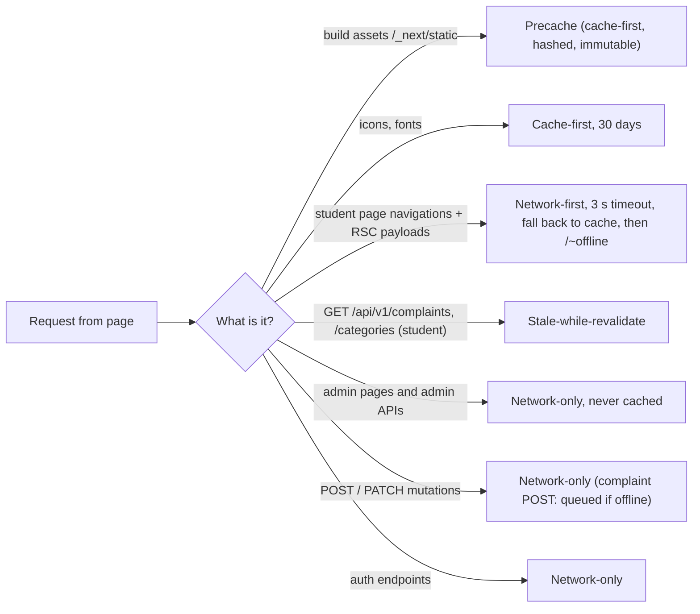
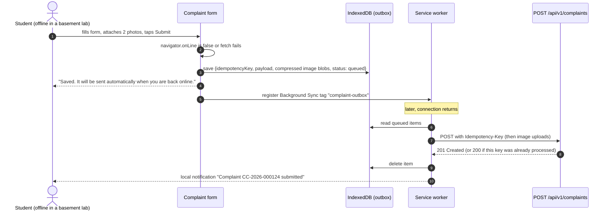

# 07 · PWA & Mobile Experience

> **Goal:** students install CampusConnect from the browser onto their phone (Android, iOS) or desktop (Windows, macOS, ChromeOS) and get an app-like experience with **every feature of the web app**, plus offline reading, offline drafts and push notifications. The same codebase serves web and installed app. Decision: ADR-012.

## 1. What "installable app" means here

| Capability | How it is delivered | Android | iOS / iPadOS | Desktop |
|---|---|---|---|---|
| Install to home screen / app list | Web App Manifest + service worker + HTTPS | Install prompt | Share, then "Add to Home Screen" (guided sheet) | Install icon in address bar |
| Full-screen app window, own icon and splash | `display: standalone`, icons, `theme_color` | Yes | Yes | Yes |
| Works offline (shell + last data) | Service worker caches (Serwist) | Yes | Yes | Yes |
| Write complaint offline, auto-send later | IndexedDB queue + Background Sync (fallback: `online` event / app start) | Yes (Background Sync) | Yes (fallback) | Yes |
| Push notifications | Web Push (VAPID) | Yes | Yes, iOS 16.4+ **when installed** | Yes |
| Camera for evidence photos | `<input type="file" accept="image/*" capture="environment">` | Yes | Yes | File picker |
| App shortcuts (long-press icon) | Manifest `shortcuts` | Yes | No | Yes |
| Badge count of unread notifications | Badging API (progressive enhancement) | Partial | Yes (installed) | Yes |

**All web features are available in the installed app** because it *is* the web app. There is no separate mobile codebase and no feature gap.

## 2. Web App Manifest (`src/app/manifest.ts`)

```ts
import type { MetadataRoute } from "next";

export default function manifest(): MetadataRoute.Manifest {
  return {
    id: "/",
    name: "CampusConnect",
    short_name: "CampusConnect",
    description: "Report campus issues and track them to resolution.",
    start_url: "/?source=pwa",
    scope: "/",
    display: "standalone",
    orientation: "portrait",
    background_color: "#ffffff",
    theme_color: "#1d4ed8",
    categories: ["education", "productivity"],
    icons: [
      { src: "/icons/icon-192.png", sizes: "192x192", type: "image/png" },
      { src: "/icons/icon-512.png", sizes: "512x512", type: "image/png" },
      { src: "/icons/maskable-512.png", sizes: "512x512", type: "image/png", purpose: "maskable" },
    ],
    screenshots: [
      { src: "/screenshots/mobile-home.png", sizes: "1080x1920", type: "image/png", form_factor: "narrow" },
      { src: "/screenshots/desktop-dashboard.png", sizes: "1920x1080", type: "image/png", form_factor: "wide" },
    ],
    shortcuts: [
      { name: "New complaint", url: "/student/complaints/new", icons: [{ src: "/icons/shortcut-new.png", sizes: "96x96" }] },
      { name: "My complaints", url: "/student/complaints" },
    ],
  };
}
```

Why these fields: `id` keeps the installed app's identity stable even if `start_url` changes. `screenshots` with `form_factor` unlock the **richer install dialog** on Android and desktop Chrome. A **maskable** icon keeps Android adaptive icons from being cropped. `?source=pwa` lets analytics measure installed-app usage.

iOS also needs `apple-touch-icon` and `apple-mobile-web-app-*` meta tags, which are generated through Next.js `metadata`.

## 3. Service worker caching strategy (Serwist)



| Resource | Strategy | Why |
|---|---|---|
| `/_next/static/*` (JS, CSS) | **Precache** at install. Hashed names, so cache-first forever. | Instant start and offline shell |
| App icons, fonts | Cache-first, 30-day expiry | Rarely change |
| Student pages (`/student/**`) and RSC payloads | **Network-first** with 3 s timeout, cache fallback | Fresh when online, last-known data when offline |
| `GET /api/v1/categories` | Stale-while-revalidate | Needed to write a complaint offline |
| `GET /api/v1/complaints` (student) | Stale-while-revalidate, max 50 entries, 7 days | Offline "My complaints" |
| Attachment images | Cache-first, max 60 entries, 7 days | Re-viewing evidence offline. Signed URLs are normalized to the attachment ID as cache key. |
| `/admin/**`, admin APIs | **Network-only** | Contains many students' data, and must never sit on disk |
| `/api/auth/**` | Network-only | Security |
| Anything uncached while offline | `/~offline` fallback page | Clear message instead of the browser's dinosaur page |

## 4. Offline complaint drafts (the key offline feature)



Design rules:
- The **Idempotency-Key** is generated **when the draft is created**, not when it is sent, so any number of retries produces exactly one complaint (`UNIQUE (student_id, idempotency_key)`).
- **Safari / iOS has no Background Sync.** The app also drains the outbox on the `online` event, on app start and on `visibilitychange`. Same code path, so it is tested once.
- Queued drafts are visible in "My complaints" with a **"Waiting to send"** chip, and can be edited or deleted before sending.
- If a queued draft fails validation on the server (e.g. a category was deactivated), it moves to **"Needs attention"** instead of retrying forever.
- Drafts are stored **per user ID** and deleted on logout (§6).

## 5. Updates

When a new version is deployed, the new service worker installs in the background and **waits**. The UI shows a small banner, *"A new version of CampusConnect is available. Reload"*. Tapping it sends `SKIP_WAITING` and reloads.

Why not activate automatically? Activating a new worker mid-session could serve new JS against old cached pages, causing errors halfway through a form. Letting the user choose is the safe pattern.

## 6. Security and privacy of the offline layer

| Risk | Mitigation |
|---|---|
| Shared lab computer: the next user sees the previous student's cached complaints | **On logout:** the page posts `CLEAR_USER_DATA` to the service worker, which deletes all runtime caches; IndexedDB is cleared; the push subscription is removed from the server. Login offers a "shared computer" option (session cookie only, no runtime caching). |
| Admin data on disk | Admin routes are **network-only**: never written to Cache Storage |
| Stale authorization (cached page after role change) | Cached pages are display-only. Every mutation goes to the server, which re-checks authorization. |
| Service worker hijack | SW served from our origin only, `scope: "/"`, CSP applies, and `Cache-Control: no-cache` on `sw.js` so updates are always picked up |

## 7. Push notifications

| Step | Detail |
|---|---|
| Permission | **Never asked on first visit.** Asked after the student submits their first complaint: "Get notified when the department responds?" A contextual ask gets better acceptance and doesn't annoy. |
| Subscribe | `pushManager.subscribe({ userVisibleOnly: true, applicationServerKey: VAPID_PUBLIC_KEY })`, then `POST /api/v1/push-subscriptions` |
| Send | Server uses `web-push` with VAPID keys. Payload is **encrypted** and contains no complaint text (lock-screen privacy). |
| Click | `notificationclick` opens or focuses `/student/complaints/:id` |
| Cleanup | A `404` / `410` from the push service deletes the subscription automatically |
| iOS | Works only after Add to Home Screen (iOS 16.4+). The UI detects iOS Safari when not installed and shows install instructions. |

## 8. Install experience

- **Android / desktop Chromium:** capture `beforeinstallprompt`, then show our own **"Install app"** button in the header and on the student dashboard (not an immediate popup).
- **iOS Safari:** no install prompt API, so we show a one-time bottom sheet with the Share, then "Add to Home Screen" steps and an illustration. It can be dismissed and won't return for 30 days.
- **Already installed** (`display-mode: standalone` matches): all install UI is hidden.

## 9. Responsive design (one UI, every screen)

| Breakpoint | Student layout | Admin layout |
|---|---|---|
| < 640 px (phones) | **Bottom tab bar**: Home · My complaints · New (+) · Notifications · Profile. One-column cards. Sticky primary button. | Usable but simplified: queue list, then a detail sheet. Charts stacked. |
| 640 to 1024 px (tablets) | Two-column cards, bottom bar becomes a side rail | Collapsible sidebar, list + detail split |
| > 1024 px (desktop) | Sidebar navigation, wide timeline | **Full sidebar**, data table with filters, side-by-side charts |

Mobile-specific details:
- Touch targets ≥ 44×44 px. Form inputs ≥ 16 px font (stops iOS from zooming on focus).
- `env(safe-area-inset-*)` padding for notched phones in standalone mode.
- The complaint form is **one short screen**: category tiles (big icons), then issue type chips, title, description, optional photos, then submit. Fewer steps means more complaints filed.
- Similar-complaint suggestions appear under the title field as you type (FX-07).
- Light and dark themes follow the OS setting, with a manual toggle.
- `prefers-reduced-motion` respected. Skeleton loaders instead of spinners.

## 10. PWA quality checklist (release gate)

Lighthouse removed its PWA category in v12, so installability is verified with this checklist (Chrome DevTools Application panel + Playwright):

| # | Check |
|---|---|
| P-01 | Manifest valid: name, icons 192 and 512, maskable icon, `id`, `start_url`, `display: standalone` |
| P-02 | Service worker registered, controls the page, and `sw.js` served with `no-cache` |
| P-03 | Installs on Android Chrome, desktop Chrome/Edge and iOS Safari (manual device check) |
| P-04 | Airplane mode: app opens, shows "My complaints" from cache, unknown pages show `/~offline` |
| P-05 | Offline submit is queued, then sent exactly once when back online (Playwright `context.setOffline`) |
| P-06 | Logout clears Cache Storage and IndexedDB (Playwright asserts empty) |
| P-07 | Admin pages are never present in Cache Storage |
| P-08 | Push received on Android and on installed iOS. Click opens the right complaint. |
| P-09 | Update banner appears after deploying a new version |
| P-10 | Core Web Vitals on a mid-range Android over throttled 4G: LCP ≤ 2.5 s, INP ≤ 200 ms, CLS ≤ 0.1 |

## 11. Device test matrix

| Device | Browser | Must pass |
|---|---|---|
| Android 10+ mid-range (e.g. Samsung A-series) | Chrome | P-01 to P-10 |
| iPhone (iOS 17+) | Safari, installed | P-01 to P-09 (P-05 via the fallback path) |
| Windows 11 laptop | Edge, Chrome | P-01 to P-07, P-09 |
| macOS | Safari, Chrome | P-01 to P-07 |
