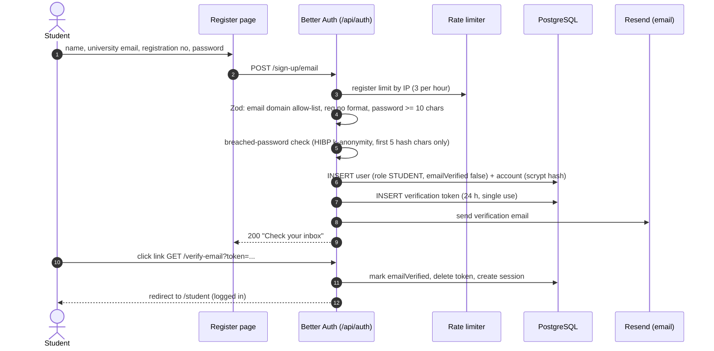
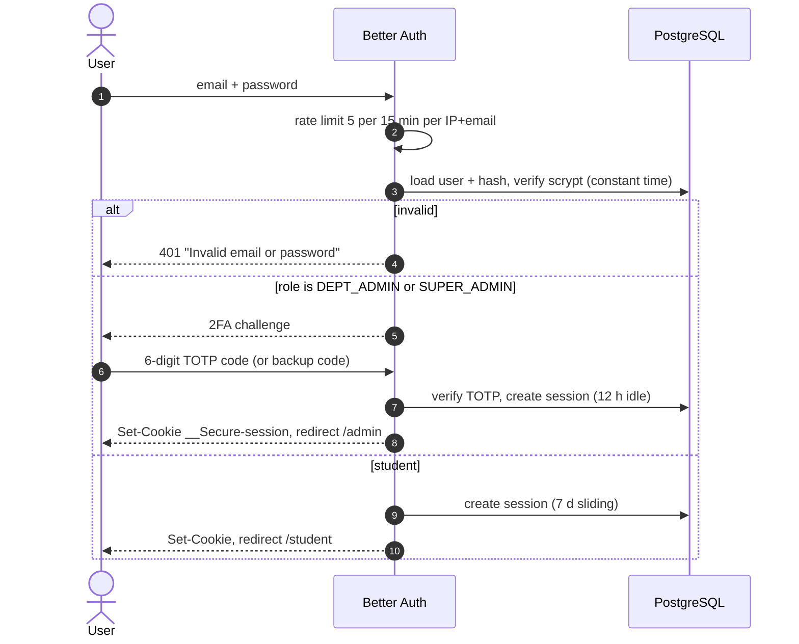
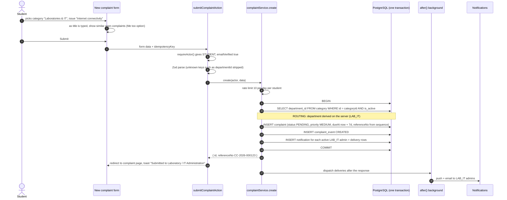
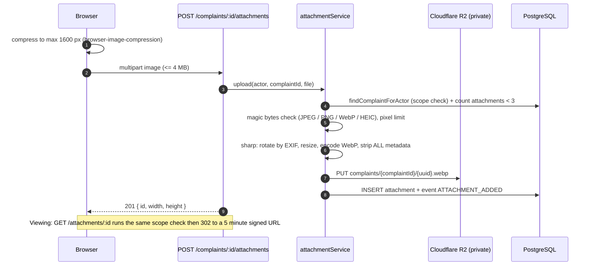
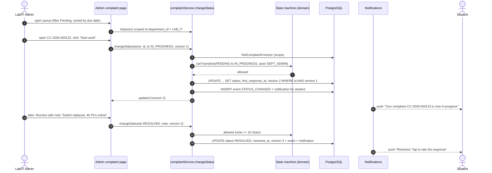
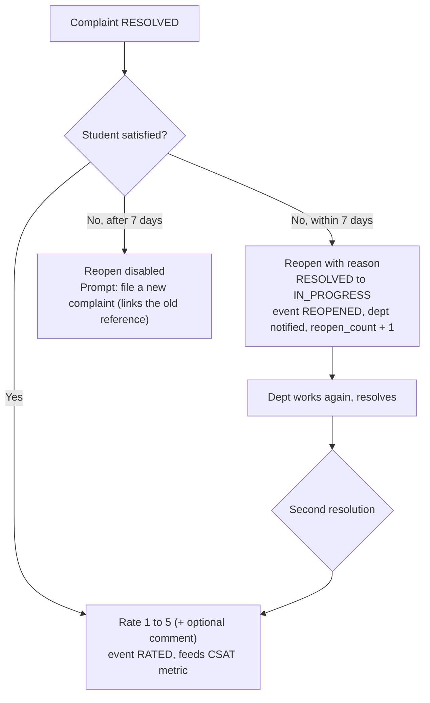
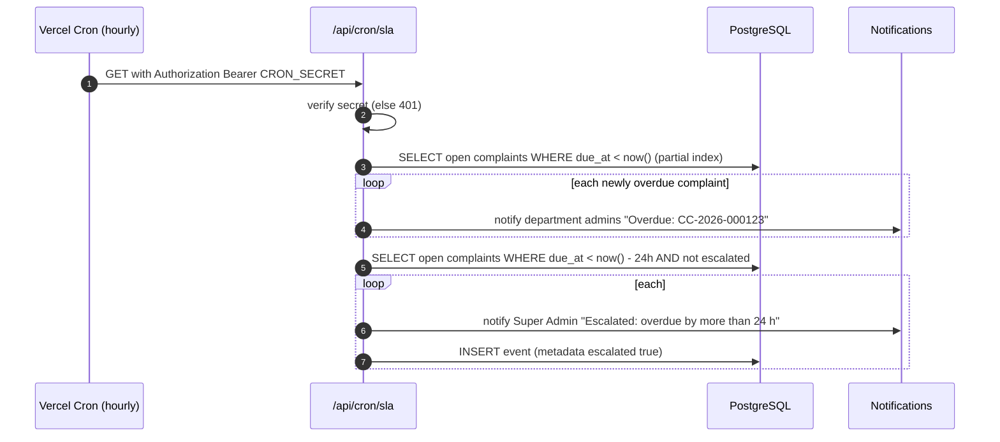
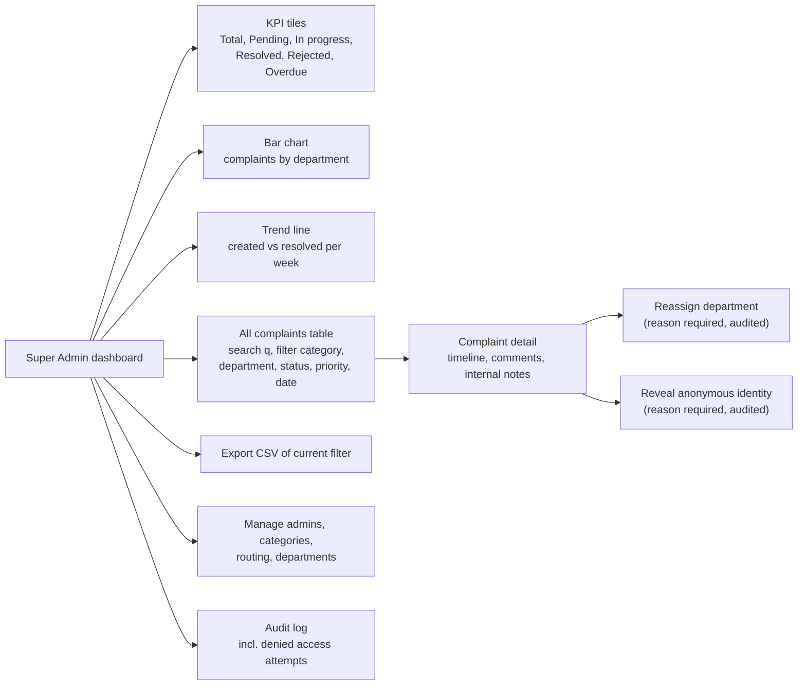

# 08 · Core Workflows

> Step-by-step behaviour of the main use cases as sequence diagrams, showing **where each rule is enforced**. Authorization details are in [05](05-security-and-access-control.md) and the offline draft flow is in [07](07-pwa-and-mobile.md) §4.

## 1. Student registration and email verification (FR-01)

Notes: if the email is already registered, the response is **the same** "Check your inbox" message, and the existing owner gets a "someone tried to register with your email" mail instead. This prevents account enumeration.

## 2. Login, including admin 2FA

## 3. Submit a complaint with automatic routing (FR-02, FR-03)

Images are uploaded right after creation (one request per image, see §4), so a slow photo upload never blocks the complaint itself.

## 4. Image upload pipeline (ADR-011)

## 5. Department admin processes a complaint (FR-06, FR-07)

**Conflict case:** if a second Lab/IT admin had rejected it in the meantime, the `UPDATE ... WHERE version = 2` matches 0 rows, the service returns **409**, and the UI says *"This complaint was updated by someone else. Reload to see the latest."*

## 6. Student reopens or rates (FX-08)

Reopen is allowed **once**. A second dispute escalates to the Super Admin as a flagged complaint, which keeps a complaint from bouncing back and forth forever.

## 7. SLA monitoring and escalation (FX-06)

The job is **idempotent**: it records what it has already notified in event metadata, so running it twice (retries, manual trigger) never double-notifies.

## 8. Super Admin oversight (FR-09, FR-11, FR-12)

## 9. Complaint conversation (FX-04)

- The student and department exchange **public comments**. Each one notifies the other side.
- Staff can add **internal notes** (`isInternal = true`). These are filtered out **in the repository query** for student actors, so they never reach the student's browser.
- Comments are plain text (max 2,000 characters), rendered with React's automatic escaping. Links are auto-detected and rendered with `rel="noopener noreferrer nofollow"`.
