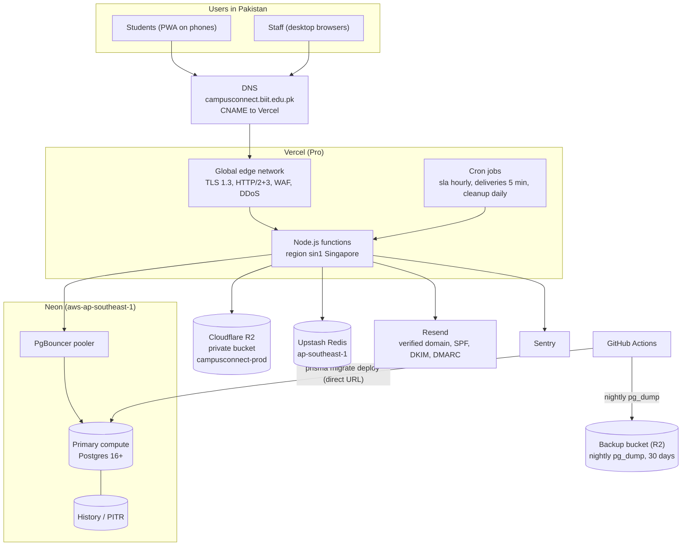
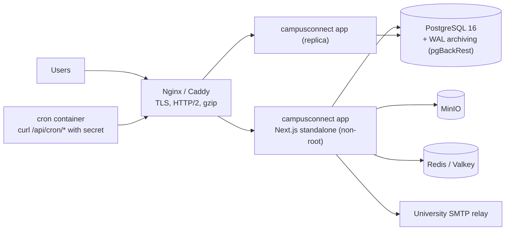

# 09 · Deployment & Operations

> The deployment follows from the stack: PostgreSQL (ADR-003) means a **managed, pooled Postgres** (Neon). Next.js (ADR-002) means **Vercel**. Images mean **S3-compatible storage** (R2). Everything sits in or near **Singapore** for Pakistani users (ADR-005), and everything can be moved to university servers through Docker (ADR-022).

## 1. Production topology

## 2. Environments

| Environment | URL | App | Database | Storage | Data | Purpose |
|---|---|---|---|---|---|---|
| **Local** | `localhost:3000` | `next dev` | Postgres 16 in Docker Compose | MinIO in Docker | Demo seed | Development |
| **Preview** | `campusconnect-git-<branch>.vercel.app` | Vercel preview deployment | **Neon branch per PR** (copy-on-write from `staging`) | R2 `campusconnect-preview` | Demo seed | Review, E2E tests, stakeholder demos |
| **Staging** | `staging.campusconnect…` | Vercel (branch `staging`) | Neon branch `staging` | R2 `campusconnect-staging` | Demo seed + anonymized copies | Pre-release check, UAT with departments |
| **Production** | `campusconnect.biit.edu.pk` | Vercel production | Neon `main` branch | R2 `campusconnect-prod` | Real | Live |

**Why separate credentials per environment:** a bug or leaked key in a preview can never touch real student data. Vercel environment variables are scoped to *Production* or *Preview*.

## 3. Local development stack (`docker-compose.dev.yml`)

| Service | Image | Port | Replaces in production |
|---|---|---|---|
| `postgres` | `postgres:16-alpine` | 5432 | Neon |
| `minio` | `minio/minio` | 9000 / 9001 | Cloudflare R2 |
| `redis` | `redis:7-alpine` + `serverless-redis-http` | 6379 / 8079 | Upstash |
| `mailpit` | `axllent/mailpit` | 1025 / 8025 | Resend (catches all mail in a web UI) |

`npm run dev:up` starts the stack, applies migrations and seeds demo data. A new developer is productive in one command.

## 4. Configuration (environment variables)

Validated at boot by `src/lib/env.ts` (Zod). The app **refuses to start** if a variable is missing or malformed.

| Variable | Example / format | Scope |
|---|---|---|
| `APP_ENV` | `production` / `preview` / `development` | all |
| `APP_URL` | `https://campusconnect.biit.edu.pk` | all |
| `DATABASE_URL` | Neon **pooled** URL (`-pooler` host, `sslmode=require`) | runtime |
| `DATABASE_URL_UNPOOLED` | Neon **direct** URL | migrations (CI) |
| `BETTER_AUTH_SECRET` | 32+ random bytes, base64 | server |
| `ALLOWED_EMAIL_DOMAINS` | `biit.edu.pk` (comma-separated) | server |
| `REG_NO_PATTERN` | regex for registration numbers | server |
| `R2_ACCOUNT_ID`, `R2_ACCESS_KEY_ID`, `R2_SECRET_ACCESS_KEY`, `R2_BUCKET` | from Cloudflare | server |
| `S3_ENDPOINT` | set only for MinIO (self-host / local) | server |
| `UPSTASH_REDIS_REST_URL`, `UPSTASH_REDIS_REST_TOKEN` | from Upstash | server |
| `RESEND_API_KEY`, `EMAIL_FROM` | `CampusConnect <no-reply@campusconnect.biit.edu.pk>` | server |
| `NEXT_PUBLIC_VAPID_PUBLIC_KEY`, `VAPID_PRIVATE_KEY`, `VAPID_SUBJECT` | generated once with `web-push generate-vapid-keys` | public / server |
| `CRON_SECRET`, `HEALTH_SECRET` | random | server |
| `SENTRY_DSN`, `NEXT_PUBLIC_SENTRY_DSN`, `SENTRY_AUTH_TOKEN` | from Sentry | server / client / CI |

## 5. CI/CD pipeline

```mermaid
flowchart LR
    subgraph PR["Pull request"]
        A["Install (npm ci, cached)"] --> B["Lint + format check"]
        B --> C["Typecheck (tsc --noEmit)"]
        C --> D["Unit tests (Vitest)<br/>policy, state machine, SLA"]
        D --> E["Integration tests<br/>Postgres service container<br/>migrate + DAL scope tests"]
        E --> F["Build (next build)"]
        F --> G["Security<br/>npm audit, dependency review,<br/>gitleaks, CodeQL"]
        G --> H["Vercel preview + Neon branch"]
        H --> I["Playwright E2E + axe<br/>against preview URL"]
    end
    subgraph MAIN["Merge to main"]
        J["Re-run checks"] --> K["prisma migrate deploy<br/>(production, direct URL)"]
        K --> L["Vercel production deploy"]
        L --> M["Smoke test<br/>/api/health, login page"]
        M --> N["Sentry release + source maps"]
    end
    I --> J
```

**Workflows** (`.github/workflows/`):

| File | Trigger | Does |
|---|---|---|
| `ci.yml` | PR, push | Steps A to G |
| `preview.yml` | PR opened or updated / closed | Create or delete the Neon branch (`neondatabase/create-branch-action`), run migrations on it, then E2E against the Vercel preview |
| `deploy.yml` | Push to `main` | Migrations, then `vercel deploy --prod` (prebuilt), then smoke test |
| `backup.yml` | Nightly 02:00 PKT (`0 21 * * *` UTC) | `pg_dump --format=custom`, encrypt (age), upload to the backup bucket, prune > 30 days |

## 6. Database migrations (zero-downtime rules)

1. Migrations are created locally with `prisma migrate dev`, reviewed in the PR as **SQL files**, and applied in CI with `prisma migrate deploy`. Never `db push` in shared environments.
2. **Expand, then migrate, then contract:**
   - *Release N:* add the new column (nullable or with a default), write to both.
   - *Backfill* in a separate script or migration.
   - *Release N+1:* read from the new column.
   - *Release N+2:* drop the old column.
3. Indexes on large tables use `CREATE INDEX CONCURRENTLY` (a migration with no transaction wrapper).
4. **Why:** Vercel rollback is instant, but it rolls back **code**, not the schema. Expand/contract makes sure the previous release still works against the new schema.

## 7. First production launch checklist

| # | Step |
|---|---|
| 1 | Create the Neon project (Singapore) on a paid plan, then copy the pooled and direct URLs |
| 2 | Create R2 buckets `campusconnect-prod` and `campusconnect-backups` (both private) and a token scoped to them |
| 3 | Create the Upstash Redis database (ap-southeast-1) |
| 4 | Verify the sending domain in Resend: add SPF, DKIM and **DMARC** records so emails don't land in spam |
| 5 | Generate VAPID keys, `BETTER_AUTH_SECRET`, `CRON_SECRET` and `HEALTH_SECRET` |
| 6 | Set every variable in Vercel (Production scope), with the function region set to `sin1` |
| 7 | Ask university IT for a CNAME `campusconnect.biit.edu.pk` pointing to Vercel. TLS is issued automatically. |
| 8 | Merge to `main`, so CI migrates and deploys |
| 9 | Run `npm run seed:prod` from CI (manual dispatch): departments, categories, issue types and admin accounts with random one-time passwords |
| 10 | Hand credentials to each department in person. First login forces a password change and 2FA setup. |
| 11 | Configure the uptime monitor (`/api/health`, 1 min) and Sentry alert rules |
| 12 | Restore drill: restore last night's backup into a scratch Neon branch and run the smoke tests |

## 8. Backups and disaster recovery

| Mechanism | Covers | RPO | RTO |
|---|---|---|---|
| **Neon point-in-time restore** (history retention on paid plan, at least 7 days) | Bad migration, accidental delete, corruption | Seconds | ~15 min (branch from a timestamp, repoint `DATABASE_URL`) |
| **Nightly `pg_dump`** to R2, encrypted, 30-day retention | Provider-level loss, account compromise, need for an independent copy | 24 h | ~1 h |
| **R2 images** | Object versioning on, lifecycle rule keeps 30 days of deleted versions | n/a | Minutes |
| **Code and config** | Git (GitHub) + documented env list | n/a | Redeploy in minutes |

**Restore drills** run once per semester and the result is written down. A backup that has never been restored isn't counted as a backup.

## 9. Monitoring and alerting

| Signal | Tool | Alert when | Who |
|---|---|---|---|
| Uptime of `/api/health` | Better Stack / UptimeRobot (1 min) | 2 consecutive failures | Dev team (email + Telegram) |
| Unhandled errors | Sentry | New issue, or > 10 events / 5 min | Dev team |
| Performance | Sentry traces, Vercel Speed Insights | p95 API > 800 ms for 15 min | Dev team |
| Denied access spikes | Audit log query (daily cron report) | > 20 `DENIED` from one actor per day | Super Admin |
| Login failures | Auth logs | > 100 failures / 10 min | Dev team |
| Delivery failures | `notification_delivery` with `FAILED` | > 5 per hour | Dev team |
| DB storage and compute | Neon console | 80 % of plan | Dev team |
| Overdue complaints | App (SLA cron) | Each escalation | Super Admin (product alert, not ops) |

## 10. Runbooks

| Situation | Action |
|---|---|
| **Bad deploy** (errors spike after release) | Vercel dashboard, Deployments, previous one, **Instant Rollback** (< 1 min). Then investigate in Sentry. Schema stays compatible (§6). |
| **Bad migration / data damage** | Freeze writes (`MAINTENANCE_MODE=true` env shows a banner and blocks mutations). Neon: create a branch at a timestamp before the incident, verify, then repoint `DATABASE_URL`. Redeploy. |
| **Leaked secret** | Rotate in the provider, update Vercel env, redeploy. For `BETTER_AUTH_SECRET`, all sessions end and users log in again. |
| **Compromised admin account** | Super Admin deactivates the user (revokes sessions), reviews that actor's audit log, resets 2FA. |
| **Email not arriving** | Check Resend logs and DNS (SPF/DKIM/DMARC). In-app and push still work. |
| **Neon or Vercel outage** | Status pages. Pages fall back to the PWA's offline cache, and complaints queue locally (PWA outbox). |

## 11. Cost estimate (monthly, approximate, verify at purchase)

| Service | Plan | Est. USD / month | Notes |
|---|---|---|---|
| Vercel | Pro (1 seat) | ~20 | Required for commercial or organizational use and frequent cron |
| Neon | Launch (usage-based) | ~15 to 30 | Small database, low compute at this scale |
| Cloudflare R2 | Pay as you go | ~0 to 2 | 10 GB free, **no egress fees** |
| Upstash Redis | Free / pay as you go | ~0 to 2 | Far below free-tier limits |
| Resend | Free (3,000 emails / month) then Pro | 0 to 20 | Depends on email volume |
| Sentry | Developer / Team | 0 to 26 | Free tier may be enough |
| Domain | University subdomain | 0 | Provided by university IT |
| **Total** | | **≈ 35 to 100** | No servers to buy, patch or staff |

## 12. Self-hosted alternative (university data centre)

If policy requires on-premises hosting, the same build runs as containers (ADR-022):

What changes: only environment variables (`S3_ENDPOINT`, `REDIS_URL`, `SMTP_*`) and the backup tool (pgBackRest instead of Neon PITR). What stays the same: every line of application code. The production Dockerfile and compose file will be generated and audited with the **vibe-ship** skill when we reach this phase.

## 13. Scaling path (if usage grows)

| Trigger | Step |
|---|---|
| DB CPU > 70 % sustained | Increase Neon compute size (autoscaling range) |
| Dashboard queries slow | Materialized view for analytics, refreshed every 5 min (ADR-016) |
| Many universities (multi-tenant) | Add `tenant_id` to every table + scope, or one deployment per university |
| Heavy notification fan-out | Move deliveries to a queue (QStash / SQS) behind the same interface |
| Read-heavy load | Neon read replica for analytics and exports |
