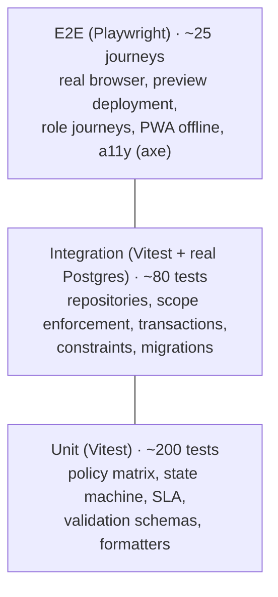

# 10 · Engineering Standards & Testing

> "Production-ready" means more than "it runs". It means typed, tested, reviewed, observable and boring to operate. These are the rules every pull request follows.

## 1. Code standards

| Area | Standard | Enforced by |
|---|---|---|
| Language | TypeScript `strict`, `noUncheckedIndexedAccess`, no `any` (use `unknown` + Zod) | `tsc`, ESLint |
| Formatting | Prettier (default config + Tailwind class sorting) | CI check, pre-commit |
| Lint | ESLint (Next.js core-web-vitals, typescript-eslint strict, jsx-a11y, import rules for layer boundaries, `no-restricted-syntax` against `dangerouslySetInnerHTML`) | CI |
| Layer boundaries | `app/` may not import `@prisma/client`. `domain/` may not import `next`, `prisma` or `fetch`. | `import/no-restricted-paths` |
| Server-only code | Files touching secrets or the DB start with `import "server-only"` | Build error if bundled client-side |
| Naming | Files `kebab-case.ts`, components `PascalCase`, functions `camelCase`, DB `snake_case` via `@map` | Review |
| Errors | Throw typed domain errors and map them to HTTP in one place. Never `throw "string"`. | Review + lint |
| Comments | Explain **why**, not what. Every exported service function has a one-line TSDoc. | Review |
| Dependencies | Every new dependency needs a reason in the PR (size, maintenance, licence) | Review, dependency-review action |

## 2. Git workflow

| Topic | Rule | Why |
|---|---|---|
| Branching | Trunk-based: short-lived `feat/*`, `fix/*`, `docs/*` branches off `main` | Small PRs, fewer conflicts |
| Commits | **Conventional Commits** (`feat(complaints): add reopen within 7 days`) | Readable history, automatic changelog |
| Authorship | Commits are authored by the team (Sudais Khalid, Farooq Khan), with `Co-authored-by` trailers for pair work | Clear ownership |
| PRs | Template: what, why, screenshots, FR/ADR references, test evidence, migration notes | Reviewable |
| Protection | `main` requires 1 approval + green CI. No force-push. | Quality gate |
| Releases | Tag `vYYYY.MM.N` on production deploys, with release notes from commits | Traceability for the university |

## 3. Testing strategy



| Layer | Tool | What it proves | Speed |
|---|---|---|---|
| **Unit** | Vitest | Pure domain logic: `can()`, `complaintScope()`, `TRANSITIONS`, SLA maths, Zod schemas | ms, every save |
| **Integration** | Vitest + Postgres (Docker service in CI) | The **SQL** really filters by scope, constraints reject bad data, transactions roll back, idempotency works | seconds |
| **E2E** | Playwright (Chromium, WebKit, mobile viewport) | Full journeys through the real UI on a preview deployment | minutes, every PR |
| **Accessibility** | `@axe-core/playwright` on every page in E2E | No WCAG A/AA violations | in E2E |
| **Security** | Suite S-01 to S-17 ([05](05-security-and-access-control.md) §9) + role × resource matrix | Authorization can't be bypassed | in integration and E2E |
| **PWA** | Checklist P-01 to P-10 ([07](07-pwa-and-mobile.md) §10) | Installable, offline, push, logout purge | E2E + manual devices |
| **Load (pre-launch)** | k6, 100 virtual users on staging | p95 within budget at 10× expected peak | once per release cycle |

### 3.1 Why integration tests use a real database

Mocking Prisma would test that "we called `findFirst` with the scope", not that **the scope actually excludes rows**. The single most important property of this system, server-side authorization, lives in SQL, so it is tested against Postgres.

### 3.2 Critical E2E journeys

| # | Journey |
|---|---|
| E-01 | Student registers, verifies email, submits a Lab/IT complaint with a photo, and sees it routed to Laboratory / IT Administration |
| E-02 | Lab/IT admin (with 2FA) sees it in the queue, starts work, comments, resolves. The student sees the timeline and rates it. |
| E-03 | **Library admin pastes the Lab/IT complaint URL and gets the Access denied page** (the brief's scenario) |
| E-04 | Student A can't open Student B's complaint URL |
| E-05 | Rejection without a reason is blocked, and with a reason it is shown to the student |
| E-06 | Super Admin filters by department, status and category, then searches by reference number |
| E-07 | Super Admin dashboard bar chart totals equal the per-department table totals |
| E-08 | Dept admin dashboard numbers only include their department |
| E-09 | Anonymous complaint: dept admin sees "Anonymous student", Super Admin can reveal it with a reason |
| E-10 | Offline: complaint queued, back online, submitted exactly once |
| E-11 | Logout purges caches and IndexedDB |
| E-12 | Reopen within 7 days works. After 7 days it is blocked. |
| E-13 | Two admins edit the same complaint: the second gets the conflict message |
| E-14 | Mobile viewport (Pixel 7, iPhone 14): full submit flow with bottom navigation |

## 4. Coverage and quality gates (CI blocks merge if any fail)

| Gate | Threshold |
|---|---|
| Typecheck, lint, format | 0 errors |
| Unit coverage on `src/domain/**` | ≥ 90 % lines and branches |
| Overall unit + integration coverage | ≥ 80 % lines on `src/modules/**` |
| Security suite + role matrix | 100 % pass |
| E2E critical journeys | 100 % pass |
| axe accessibility | 0 serious or critical violations |
| `npm audit` (production deps) | 0 high or critical |
| Bundle budget | Student routes ≤ 180 KB gzipped JS on first load |

## 5. Performance budgets

| Metric | Budget | How we stay in it |
|---|---|---|
| LCP (mobile, 4G) | ≤ 2.5 s | Server Components, streaming, `next/font`, no client data waterfalls |
| INP | ≤ 200 ms | Minimal client JS, transitions for navigation |
| CLS | ≤ 0.1 | Reserved image dimensions, skeletons |
| API p95 | ≤ 300 ms | Co-located DB, indexes from [04](04-data-model.md) §7, no N+1 (Prisma `select`/`include` reviewed) |
| DB query p95 | ≤ 50 ms | Indexes. `EXPLAIN ANALYZE` on new queries in review. |

## 6. Logging conventions

```json
{ "level": "info", "time": "2026-11-19T04:00:00.123Z", "requestId": "req_01JD2Y8M3K",
  "route": "PATCH /api/v1/complaints/:id/status", "actorId": "0193...", "role": "DEPT_ADMIN",
  "complaintId": "0193...", "from": "PENDING", "to": "IN_PROGRESS", "durationMs": 42, "outcome": "ok" }
```

- **Never log:** passwords, tokens, cookies, complaint descriptions, comment bodies, full email addresses (mask as `m***@biit.edu.pk`).
- `requestId` is generated in the proxy, returned in the `X-Request-Id` header and in every problem+json, so a student's error screenshot leads straight to the log line.

## 7. Definition of Done

A feature is **done** when all of these are true:

1. It meets its FR/FX acceptance criteria, and the PR references the IDs.
2. Authorization is enforced in the DAL, with an integration test for allowed **and** denied cases.
3. Inputs are validated with Zod and errors map to the problem+json format.
4. Unit, integration and E2E tests are added and green.
5. It works at 360 px width, passes keyboard navigation and has no axe violations.
6. Loading, empty and error states are designed (no blank screens).
7. Any migration follows expand/contract and was reviewed as SQL.
8. Logs and Sentry breadcrumbs exist for failure paths, with no PII.
9. Docs are updated (this folder) if architecture, API or data model changed. A new ADR is added for significant decisions.
10. It was verified on the preview deployment by someone other than the author.

