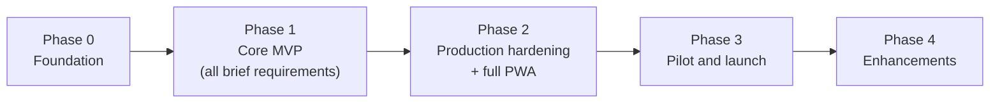

# 11 · Delivery Roadmap & Risks

> The build happens in phases. Every phase ends **deployed and usable**, so the university always has a working system and feedback arrives early.

## 1. Phases

### Phase 0 · Foundation
| Deliverable | Notes |
|---|---|
| Repository, Next.js + TypeScript strict scaffold, ESLint, Prettier, Husky | Layer boundary lint rules from day one |
| Docker Compose dev stack (Postgres, MinIO, Redis, Mailpit) | One-command setup |
| Prisma schema v1 + first migration + seed (departments, categories, issue types, admins) | [04](04-data-model.md) |
| `env.ts`, logger, error model, `/api/health` | Cross-cutting basics |
| CI pipeline (lint, typecheck, unit, build) + Vercel project + Neon project | Deployed "hello" on the real URL **on day one** |

### Phase 1 · Core MVP (covers every requirement in the brief)
| Deliverable | Maps to |
|---|---|
| Student registration, email verification, login, logout | FR-01 |
| Complaint form with categories and issue types, server-side routing | FR-02, FR-03 |
| Student "My complaints" list, detail page, status timeline, replies | FR-04, FR-05 |
| Dept admin queue (current + history), detail, status changes with reason or note, remarks | FR-06, FR-07, FR-08 |
| Super Admin all-complaints table with search and filters | FR-09 |
| Policy + scoped DAL + security tests S-01 to S-11 | FR-10 |
| Dashboards: KPI tiles, bar chart by department, status breakdown, trend | FR-11, FR-12 |
| Image upload with re-encoding | FR-02 |
| Responsive UI (mobile-first), basic manifest so it installs | FX-01 (basic) |
| Production deployment with seeded admin accounts | FR-13, FR-14 |

**Exit criteria:** E2E journeys E-01 to E-08 pass on production. A demo runs end to end on a phone and a laptop.

### Phase 2 · Production hardening + full PWA
| Deliverable | Maps to |
|---|---|
| Admin TOTP 2FA, rate limiting, breached-password check, CSP with nonces, security headers | [05](05-security-and-access-control.md) |
| Serwist service worker, offline cache, offline draft outbox, update banner, logout purge | FX-01, [07](07-pwa-and-mobile.md) |
| Notifications: in-app, Web Push, email + delivery retries cron | FX-09 |
| Priority, SLA due dates, overdue flag, escalation cron | FX-06 |
| Comments + internal notes, withdraw, reopen, rating | FX-04, FX-08, FX-14 |
| Anonymous mode + Super Admin reveal (audited) | FX-05 |
| Similar-complaint suggestions + "Me too" | FX-07 |
| Reassignment, CSV export, audit log viewer, admin user management | FX-10 to FX-12 |
| Sentry, log drain, uptime monitor, nightly backups + restore drill | [09](09-deployment-and-operations.md) |
| Full E2E suite, axe, k6 load test on staging | [10](10-engineering-standards-and-testing.md) |

### Phase 3 · Pilot and launch
| Step | Detail |
|---|---|
| UAT with the four departments | Staff test their own queues on staging with realistic data and give feedback |
| Pilot with one batch or semester class | Real complaints, close monitoring, weekly review of metrics from [01](01-product-and-requirements.md) §1.2 |
| Staff training | 30-minute session + one-page guide per department |
| Student launch | Announcement, QR codes on posters in the cafeteria, library and labs that open the install page |
| Policy sign-off | Data retention, anonymity policy and SLA targets approved by the administration |

### Phase 4 · Enhancements (prioritized by pilot feedback)
| Idea | Value |
|---|---|
| University SSO (Microsoft 365 / Google Workspace via OIDC) | No separate password. Automatic offboarding on graduation. |
| Urdu interface (RTL) | Accessibility for all students and staff |
| More categories: Transport, Hostel, Finance, Examinations | Data-only change thanks to ADR-008 |
| Per-department SLA configuration and working-hours calendar | More accurate deadlines |
| Monthly PDF report emailed to management | Governance |
| AI-assisted *suggestion* of category and duplicate detection | Faster filing (suggestion only, never automatic routing) |
| Capacitor wrapper for Play Store / App Store presence | Only if the university wants store listings |

## 2. Risk register

| # | Risk | Likelihood | Impact | Mitigation | Owner |
|---|---|---|---|---|---|
| R-01 | Authorization bug exposes another department's or student's complaint | Low | **Critical** | Scoped DAL (ADR-007), role matrix tests on every PR, audit of denials | Both |
| R-02 | Staff don't adopt the system and keep using WhatsApp | Medium | High | Simple admin UI, push and email alerts, SLA visibility to management, training | Product |
| R-03 | Students fear retaliation and don't file teaching complaints | Medium | High | Anonymous-to-department mode, published privacy policy | Product |
| R-04 | Verification emails land in spam | Medium | Medium | SPF, DKIM and DMARC on the university subdomain, Resend reputation, in-app resend button | Sudais |
| R-05 | iOS users miss push notifications | High | Low | Email fallback, in-app badge, install guidance sheet | Farooq |
| R-06 | Vendor price or plan changes | Low | Medium | Portability via standard protocols (ADR-022), documented self-host path | Both |
| R-07 | Data residency policy forbids Singapore hosting | Low | High | Self-host stack ready (§12 of [09](09-deployment-and-operations.md)) | Both |
| R-08 | Spam or abusive complaints | Medium | Medium | Verified university emails, rate limits, Super Admin can deactivate accounts | Product |
| R-09 | Bad migration damages production data | Low | High | Expand/contract, PR review of SQL, Neon PITR, nightly dumps, restore drills | Both |
| R-10 | Key person leaves the team | Medium | Medium | This documentation, ADRs, conventional commits, runbooks | Both |

## 3. Team responsibilities (proposed)

| Area | Lead | Support |
|---|---|---|
| Architecture, data model, security, backend services | Sudais Khalid | Farooq Khan |
| UI/UX, PWA, charts, accessibility | Farooq Khan | Sudais Khalid |
| CI/CD, deployment, monitoring | Sudais Khalid | Farooq Khan |
| Testing (E2E, security suite) | Shared | Shared |

Leads are a proposal and can be swapped. Every area has a second person who reviews its PRs, so no part of the system has a single point of knowledge.
