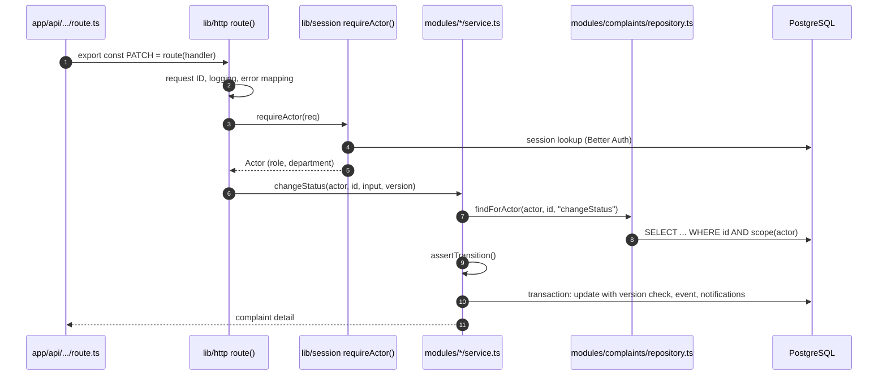

# 12 · Backend Guide

> How the backend is organised, how to run it, and where each design decision lives in the code.
> Design background: [02 Architecture](02-system-architecture.md), [05 Security](05-security-and-access-control.md), [06 API](06-api-design.md).

## 1. Run it locally

| Step | Command | Notes |
|---|---|---|
| 1. Install | `npm install` | Also runs `prisma generate` |
| 2. Configure | copy `.env.example` to `.env` | Defaults work with the Docker stack |
| 3. Start services | `npm run dev:up` | Postgres 16, MinIO (S3), Mailpit (email inbox at http://localhost:8025) |
| 4. Create tables | `npm run db:deploy` | Applies `prisma/migrations` |
| 5. Seed | `npm run db:seed` | Departments, categories, staff accounts and demo data |
| 6. Run | `npm run dev` | API at http://localhost:3000/api/v1 |
| 7. Verify | `node scripts/smoke-test.mjs` | Full lifecycle and access-control checks against the running server |

Seeded accounts (local and preview only, password from `SEED_ADMIN_PASSWORD`):

| Account | Role |
|---|---|
| `superadmin@<domain>` | Super Admin |
| `cafeteria.admin@<domain>`, `library.admin@<domain>`, `labit.admin@<domain>`, `academic.admin@<domain>` | Department admins |
| `student1@<domain>` to `student6@<domain>` | Students with demo complaints |

`<domain>` is the first entry of `ALLOWED_EMAIL_DOMAINS`. In production the seed prints a random one-time password per staff account and creates no demo data.

## 2. Scripts

| Script | Does |
|---|---|
| `npm run dev` | Next.js dev server |
| `npm run build` | `prisma generate` + production build |
| `npm run lint` | ESLint, including the layer-boundary rules |
| `npm run typecheck` | `tsc --noEmit` |
| `npm test` | Vitest unit tests (policy, state machine, SLA, CSV, validation) |
| `npm run db:migrate` | Create a new migration from schema changes (development) |
| `npm run db:deploy` | Apply migrations (CI and production) |
| `npm run db:seed` | Seed reference data, staff and demo data |
| `npm run db:studio` | Browse the database |

## 3. Code map

```text
src/
├─ domain/              pure rules, no I/O
│  ├─ types.ts          roles, statuses, priorities, Actor
│  ├─ policy.ts         complaintScope() and can(): who may see and do what
│  ├─ state-machine.ts  legal status changes and their business rules
│  ├─ sla.ts            due dates, overdue, escalation threshold
│  └─ csv.ts            CSV encoding safe against formula injection
├─ lib/                 infrastructure adapters
│  ├─ env.ts            validated configuration (fails fast)
│  ├─ db.ts             Prisma client
│  ├─ auth.ts           Better Auth: sign-up rules, sessions, 2FA, rate limits
│  ├─ session.ts        requireActor(): session to Actor, setup checks
│  ├─ http.ts           route() wrapper, problem+json errors, Zod parsing
│  ├─ errors.ts         typed errors mapped to HTTP status codes
│  ├─ rate-limit.ts     Upstash Redis (or in-memory locally)
│  ├─ storage.ts        S3 API: R2 in production, MinIO locally
│  ├─ mailer.ts         Resend, SMTP or log
│  ├─ push.ts           Web Push (VAPID)
│  ├─ background.ts     work after the response (Next.js after())
│  └─ logger.ts         pino JSON logs with request context
├─ modules/             use cases
│  ├─ complaints/       schemas, repository (scoped queries), service
│  ├─ attachments/      image re-encoding and signed URLs
│  ├─ notifications/    outbox, delivery with retries, push subscriptions
│  ├─ analytics/        SQL aggregates per scope
│  ├─ org/              categories (routing), departments, staff, audit viewer
│  ├─ account/          profile and preferences
│  ├─ audit/            audit log writer
│  ├─ jobs/             SLA escalation and cleanup
│  └─ health/           deep health check
├─ app/api/             thin route handlers (validate, call a service, respond)
└─ proxy.ts             request ID and optimistic login redirect only
```

## 4. Where the key requirements are enforced

| Requirement | Code |
|---|---|
| Server-side authorization (brief 4.1) | `domain/policy.ts` `complaintScope()` is ANDed into every query in `modules/complaints/repository.ts`. Out-of-scope access returns 403 and writes an `AuditLog` row with outcome `DENIED`. |
| Automatic routing (brief 4.2) | `createComplaint()` in `modules/complaints/service.ts` reads `category.departmentId`. The input schema has no department field. |
| Status rules | `domain/state-machine.ts`, plus `CHECK` constraints in `prisma/migrations/*_constraints_and_search`. |
| Concurrent edits | `updateIfUnchanged()` compares `version` and returns 409 on a mismatch. |
| Anonymous complaints | `presentListItem()` and `loadDetail()` in the repository replace identity and drop `studentId` for staff. |
| Dashboard scope | `scopeSql()` in `modules/analytics/service.ts` uses the same rule as the lists. |
| Safe uploads | `modules/attachments/image.ts` checks magic bytes and re-encodes to WebP, which strips EXIF and GPS. |
| Offline-safe creation | `Idempotency-Key` header plus `UNIQUE (student_id, idempotency_key)`. |
| Reliable notifications | `queueNotifications()` writes inside the business transaction. `processDueDeliveries()` retries from cron. |

## 5. Request flow in code



## 6. Adding an endpoint

1. Add or extend a Zod schema in the module's `schemas.ts`.
2. Add a service function that takes `actor` first. Load complaints only through `findForActor()` or the scoped repository functions.
3. Add the route under `src/app/api/v1/...` as `export const POST = route(async (req) => { ... })`. Route files must not import `@/lib/db` (lint enforces this).
4. Add unit tests for any new rule in `src/domain`, and extend `scripts/smoke-test.mjs` for new access rules.
5. Update [06 API](06-api-design.md).

## 7. Implementation notes (differences from the original design)

| Topic | Design said | Implemented | Why |
|---|---|---|---|
| Staff session lifetime | 12 h idle | 12 h maximum from sign-in | The auth library refreshes sessions daily, so idle time cannot be measured precisely. A hard cap is simpler and stricter. |
| Partial indexes | `WHERE status IN (...)` partial indexes | Composite indexes `(status, due_at)` and similar | Prisma cannot model partial indexes and would try to drop them on every migration. |
| Analytics cache | Tag-based invalidation | 60-second TTL per server instance | Simple and sufficient. Numbers are at most one minute old. |
| HEIC uploads | Accepted | Not accepted | The standard image library build cannot decode HEIC. iOS Safari converts photos to JPEG when uploading. |
| Sign-in rate limits | Upstash Redis, 5 per 15 min | Better Auth's limiter in the `rate_limit` table, 30 sign-ins per minute per IP | A campus usually shares one public IP, so a strict per-IP limit would lock out everyone. Upstash still limits complaint, upload, comment and export actions per user. |
| Photo storage on Vercel | Cloudflare R2 with signed URLs | Private Vercel Blob store (`sin1`), streamed through `/api/v1/attachments/:id` | Provisioned from the Vercel CLI with no extra account. Files are never public and are only sent after the complaint access check. The S3 backend remains for self-hosting. |
| Email | Resend | Authenticated SMTP (Gmail app password) until the university provides a sending domain | Resend requires a verified domain. Any SMTP server works through `SMTP_HOST`, `SMTP_USER`, `SMTP_PASSWORD`. |
| Scheduled jobs | Hourly and every 5 minutes | Daily | The Vercel Hobby plan only allows daily cron jobs. Notifications are still sent immediately after each change; cron only retries failures. |

## 8. Live deployment

| Piece | Value |
|---|---|
| App | Vercel project `campusconnect`, region `sin1`, deploys on every push to `main` |
| Database | Neon Postgres (free plan), `ap-southeast-1` |
| Photos | Vercel Blob, private store `campusconnect-photos`, `sin1` |
| Rate limits | Upstash Redis (free plan), connected through the Vercel Marketplace |
| Migrations | Run `prisma migrate deploy` with the Neon direct URL before deploying schema changes |
