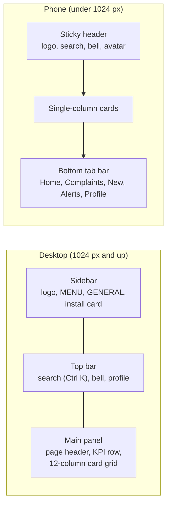

# 13 · Frontend Design System

> The web app and the installed PWA share one interface. The visual language follows the team's reference dashboard: a forest-green brand on a soft grey canvas, white rounded cards, pill-shaped controls and big confident numbers. It is adapted for complaints, two kinds of users and phones.
> Tokens live in `src/app/globals.css`. Components live in `src/components`.

## 1. Design principles

| Principle | What it means in practice |
|---|---|
| **Calm, trustworthy, official** | Deep green (growth, "resolved") instead of alarm colours. Red is reserved for rejected and overdue. |
| **Numbers first for staff** | Dashboards open with large KPI tiles, then charts, then lists. Staff can see the state of the queue at a glance. |
| **One-minute reporting for students** | The complaint form is a single screen of large tap targets: category tiles, issue chips, title, details, photos. |
| **Status is never colour alone** | Every status badge has a dot, a colour and a text label. Charts have legends and hidden data tables. |
| **Mobile is the primary student device** | The bottom tab bar and its raised centre "New" button sit in thumb reach. Inputs are 16 px so iOS does not zoom. |

## 2. Colour tokens

| Token | Value | Use |
|---|---|---|
| `canvas` | `#e9ece9` | Page background |
| `shell` | `#f5f6f5` | Sidebar, top bar and main panel on desktop, plus subtle fills |
| `surface` | `#ffffff` | Cards |
| `ink` / `ink-soft` / `muted` | `#111a14` / `#37433b` / `#5f6b64` | Text. `muted` keeps 5:1 contrast on white. |
| `brand-50` to `brand-950` | `#eef8f2` to `#082116` | Brand scale. `brand-gradient` runs 600 to 800 to 950 with a soft highlight. |
| Status: pending | `#a15c07` on `#fdf1dc` | Amber: waiting |
| Status: in progress | `#1f5f9e` on `#e3eefb` | Blue: someone is working on it |
| Status: resolved | `#1f7148` on `#e2f4e9` | Green: done |
| Status: rejected | `#b42335` on `#fde6e8` | Red: closed without a fix |
| Status: withdrawn | `#525b56` on `#eceeed` | Grey: cancelled by the student |

`bg-hatch` (diagonal stripes) marks "not yet": upcoming days in the week chart and pending work in the gauge and department bars, as in the reference design.

## 3. Typography

| Role | Font | Size and weight |
|---|---|---|
| Everything | **Plus Jakarta Sans** (`next/font`, self-hosted at build) | Recommended by the ui-ux-pro-max design search for SaaS dashboards: friendly, modern, very legible |
| Page title | | 28 px mobile, 36 px desktop, semibold, tight tracking |
| KPI numbers | | 48 px semibold, tabular numerals |
| Card title | | 18 px semibold |
| Body | | 15 to 16 px regular, line height 1.6 |
| Labels and eyebrows | | 12 px uppercase, 0.08 em tracking (sidebar "MENU" and "GENERAL") |

## 4. Shape, depth and motion

| Element | Rule |
|---|---|
| Cards | 24 px radius, white, nearly flat shadow |
| Panels (sidebar, desktop main area) | 32 px radius on the `shell` colour |
| Buttons and inputs | Fully rounded pills. Primary uses the brand gradient, secondary is outlined in brand-800. |
| Icons | Lucide line icons, 20 px in navigation, always paired with text or an `aria-label` |
| Motion | 150 to 220 ms ease-out on hover and focus. Pages fade up 6 px. All motion is turned off with `prefers-reduced-motion`. |

## 5. Layout

## 6. Screens

| Area | Screen | Highlights |
|---|---|---|
| Auth | Sign in, register, forgot or reset password, two-step code | Split screen with the brand panel and a product preview. Account-enumeration-safe messages. "Shared computer" option. |
| Staff setup | Change one-time password, set up 2FA | QR code drawn as SVG. Backup codes with a copy button. |
| Student | Dashboard | Greeting, 4 KPI tiles, recent complaints, latest update card, progress gauge, quick-report tiles, notification prompt |
| Student | Report an issue | Category tiles that show the destination department, issue chips, live "similar complaints" with **Me too**, photos (compressed on device), anonymous option, works offline |
| Student | My complaints, complaint detail | Status filters, offline outbox, timeline, conversation, rate, reopen, withdraw |
| Staff | Dashboard | KPI tiles, week pill chart, needs-attention card, most reported, recent complaints, resolution gauge, response tracker, department bars (super admin) |
| Staff | Queue, complaint detail | URL-based filters, CSV export, start, resolve and reject dialogs (reason required), priority, internal notes, reassign and reveal (super admin) |
| Staff | Analytics | Time range, received vs resolved trend, status gauge, department bars, recurring issues |
| Super admin | Staff & users, Routing, Audit log | Create staff (one-time password by email), deactivate, change category routing, denied-access log |
| All | Notifications, Settings, Help, Offline, 403, 404 | Push and email toggles, password and 2FA, role-specific FAQ |

## 7. Accessibility checklist (WCAG 2.2 AA)

- Skip link, landmarks (`header`, `nav`, `main`, `aside`) and one `h1` per page.
- Every form control has a visible label. Errors are announced (`role="alert"`) and linked with `aria-describedby`.
- Icon-only buttons have `aria-label`. Decorative icons are `aria-hidden`.
- Dialogs use the native `<dialog>` element, so focus is trapped and Escape closes them.
- Status filters are toggle buttons (`aria-pressed`). Active navigation uses `aria-current="page"`.
- Charts expose the same numbers in a visually hidden table.
- Touch targets are at least 44 px. Focus rings are always visible.

## 8. PWA behaviour (implementation of [07](07-pwa-and-mobile.md))

| Piece | File |
|---|---|
| Manifest with icons, maskable icon and shortcuts | `src/app/manifest.ts`, `public/icons/*` (PNGs from `npm run icons`) |
| Service worker: shell precache, network-first student pages, network-only admin, push, notification click, logout purge | `public/sw.js` |
| Registration, install prompt, update banner, offline banner | `src/components/pwa/*` |
| Offline complaint outbox (IndexedDB + Idempotency-Key) | `src/lib/offline-queue.ts` |
| Push subscribe and unsubscribe | `src/components/notifications/push.ts` |

Online, the service worker always fetches pages from the server; saved copies are only used offline, and a new version activates immediately (an earlier version served saved pages after a 3-second timeout, which showed outdated screens after deploys). Open pages stay current through `src/components/live-updates.tsx`: every 8 seconds while visible it reads a change stamp from `GET /api/v1/updates` and re-renders server data in place only when something in the user's scope changed. Push notifications and returning to the tab trigger an immediate check.

The service worker is hand-written instead of Serwist. It is about 150 lines, has no build plugin, and works with Turbopack. The caching rules are short enough to review line by line.
