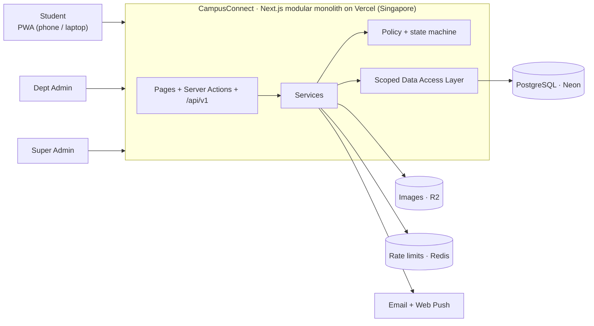

# CampusConnect · Architecture & System Design

> Smart Campus Complaint and Feedback Management System, designed as a **production product** for a real university and installable as a **PWA** on web and mobile.
> **Authors:** Sudais Khalid, Farooq Khan · **Version:** 1.0 · **Date:** 2026-11-19

## How to read these documents

| # | Document | Read it to learn |
|---|---|---|
| 01 | [Product & Requirements](01-product-and-requirements.md) | Vision, roles, categories, every requirement traced to the brief, features beyond the brief, non-functional targets, capacity |
| 02 | [System Architecture](02-system-architecture.md) | Stack at a glance, context and container diagrams, layers, modules, request lifecycle, folder layout |
| 03 | [Architecture Decisions (ADRs)](03-architecture-decisions.md) | **Why** each choice was made, the alternatives and the trade-offs (24 decisions) |
| 04 | [Data Model](04-data-model.md) | ERD, tables, constraints, state machine, SLA, indexes, Prisma schema, retention |
| 05 | [Security & Access Control](05-security-and-access-control.md) | Auth, permission matrix, **server-side enforcement**, threat model, OWASP, security tests |
| 06 | [API Design](06-api-design.md) | REST conventions, error format, every endpoint, examples, Server Actions |
| 07 | [PWA & Mobile](07-pwa-and-mobile.md) | Install, offline caching, offline drafts, push, updates, responsive layout, PWA checklist |
| 08 | [Core Workflows](08-core-workflows.md) | Sequence diagrams for registration, submission, routing, processing, SLA, uploads |
| 09 | [Deployment & Operations](09-deployment-and-operations.md) | Topology, environments, CI/CD, migrations, backups, monitoring, runbooks, cost, self-host |
| 10 | [Engineering Standards & Testing](10-engineering-standards-and-testing.md) | Code rules, git workflow, test pyramid, quality gates, Definition of Done |
| 11 | [Delivery Roadmap & Risks](11-delivery-roadmap.md) | Phases, exit criteria, risk register, responsibilities |

## The design in one diagram

## Five decisions that shape everything

1. **PostgreSQL, not MongoDB** (ADR-003): the data is relational, integrity rules live in the database, and analytics are plain SQL. Deployment follows from it: **Neon** serverless Postgres with pooling, co-located with **Vercel** in Singapore.
2. **Authorization in the Data Access Layer** (ADR-007): every query is filtered by the actor's scope **inside the SQL**, so a Library admin can't load a Lab/IT complaint even by URL. Denials return 403 and are audited.
3. **Routing is data** (ADR-008): category → department is a database relation, derived on the server and never sent by the client.
4. **One codebase for web and app** (ADR-002, ADR-012): Next.js + a Serwist service worker make an installable PWA with offline reading, offline drafts and push notifications.
5. **Portable by design** (ADR-022): every managed service uses a standard protocol, so the system can move to university servers with Docker without code changes.

## Viewing these documents

- **On GitHub:** Mermaid diagrams render automatically.
- **In VS Code:** install the *Markdown Preview Mermaid Support* extension (`bierner.markdown-mermaid`), then open the preview with `Ctrl+Shift+V`.
- **As one visual page:** open [`site/index.html`](site/index.html) in a browser (generated by `node scripts/build-docs.mjs`).
